# angelX

https://github.com/user-attachments/assets/53be0360-3b4d-4176-ac7b-c924c101c927

**[Download the full-quality film](https://github.com/newjordan/angelX/releases/download/v0.2.7/angelX-how-to-use.mp4)** (2:47, MP4): install, connect a model, set a goal and run a loop.

The product website is [omni-space.tech](https://omni-space.tech): install,
documentation, the Glass reel and the measurements published in this
repository. Source and release downloads stay on GitHub.

angelX is a terminal coding agent in Rust, for local models and API plans. On
the 136-task polyglot set with Muse Spark 1.3 it solves every task in 37.2
minutes of agent time on 6.58 M input tokens; Muse Code on the same model takes
119.8 minutes and 26.33 M. The table is [below](#new-in-027-the-muse-hackathon-update).

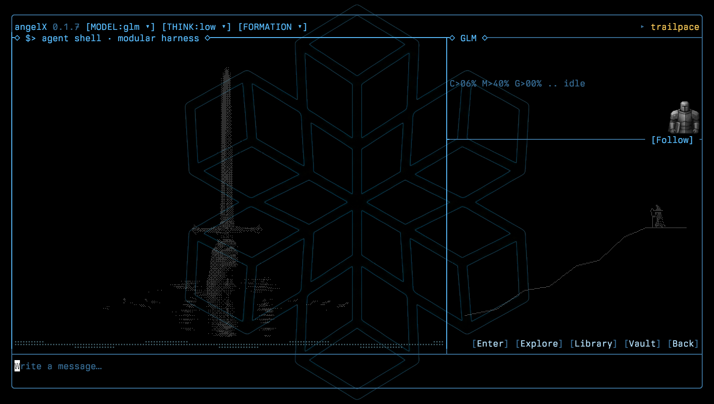

```sh
curl -fsSL https://raw.githubusercontent.com/newjordan/angelX/main/install.sh | sh
# then open a new terminal window, and:
cd your-project && angelX
```

For Linux x86_64 and arm64 (glibc 2.31 or newer) and macOS on Apple silicon.
The first launch opens a setup menu that finds the models you already have and
connects one: Ollama, LM Studio, llama.cpp or vLLM on this machine, an API key,
or a ChatGPT or Grok plan login. Type `/setup` in angelX (or run `angelX setup`) to change it later,
and `angelX update` installs the latest release.

Every prebuilt install also installs glass, angelX's own terminal
([crates/term](crates/term)), linked as `glass` next to `angelX`. The installer
never replaces a `glass` you already have. Run angelX inside glass and pictures,
video and charts show in the terminal too.

To build from source instead, you need Rust/Cargo, C/C++ tools, Bash, Node.js
and Python 3 (on macOS: `xcode-select --install`, then Rust from https://rustup.rs):

```sh
git clone https://github.com/newjordan/angelX.git
cd angelX
./bin/angelX
```

Source launches use the incremental `fast` profile. Use `ANGEL_FAST=0 ./bin/angelX`
for a release build, or `ANGEL_NO_BUILD=1 ./bin/angelX` to reopen the existing fast
binary without compiling. The first fast build warms its own cache; later edits
reuse it. See the [development workflow](CONTRIBUTING.md#setup).

To compile with Blaze instead of Cargo, install it once with
`python3 scripts/runtime/install-blaze.py`, then launch with
`ANGEL_BUILD_BACKEND=blaze ./bin/angelX`.

[Product site](https://omni-space.tech) · [Model setup](docs/MODELS.md) · [/commands](docs/COMMANDS.md) ·
[Feature evidence](docs/FEATURES.md) · [Backup and peer watch](docs/BACKUP.md) · [Attributions](THIRD_PARTY_NOTICES.md) · [MIT](LICENSE) ·
[Contributing](CONTRIBUTING.md) · [Security](SECURITY.md)

## How it works

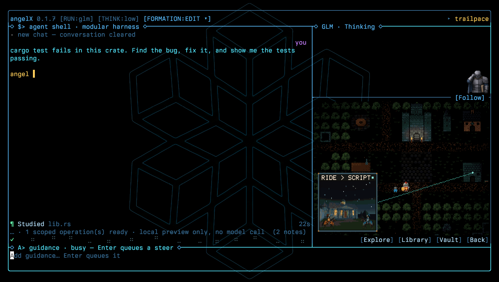

**1 · Choose a model.** `/model` lists every connected route with its thinking level; `/think` changes the level.

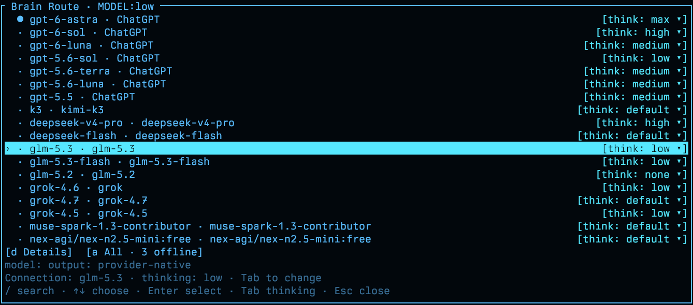

**2 · Approve what it does.** Commands and edits arrive as action capsules: approve one (`y`), approve the rest of the turn (`a`), or deny (`n`).

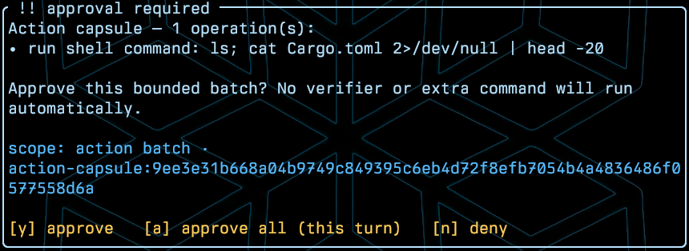

**3 · Content-checked edits.** Each edit is anchored to the file's current content and shows its byte change before it lands. `/diff` shows the result.

<p>
  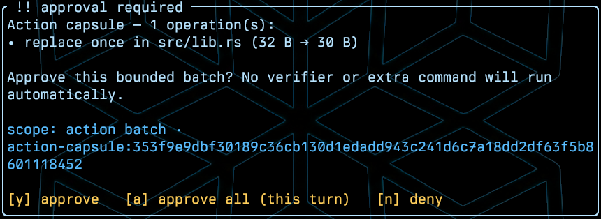
  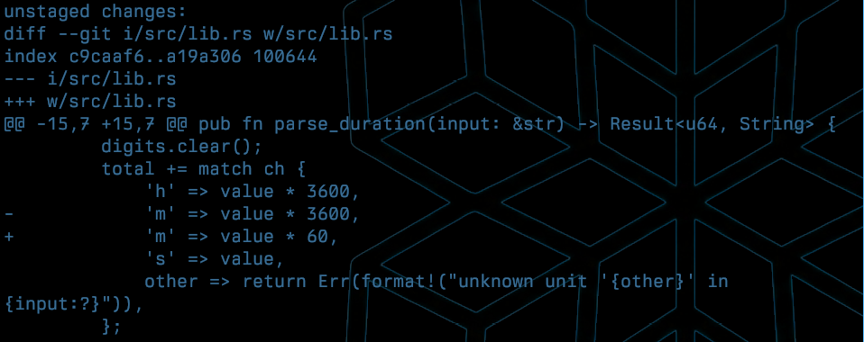
</p>

**4 · Checked before done.** The agent runs the checks and reports with receipts: every tool call, its time and the model route.

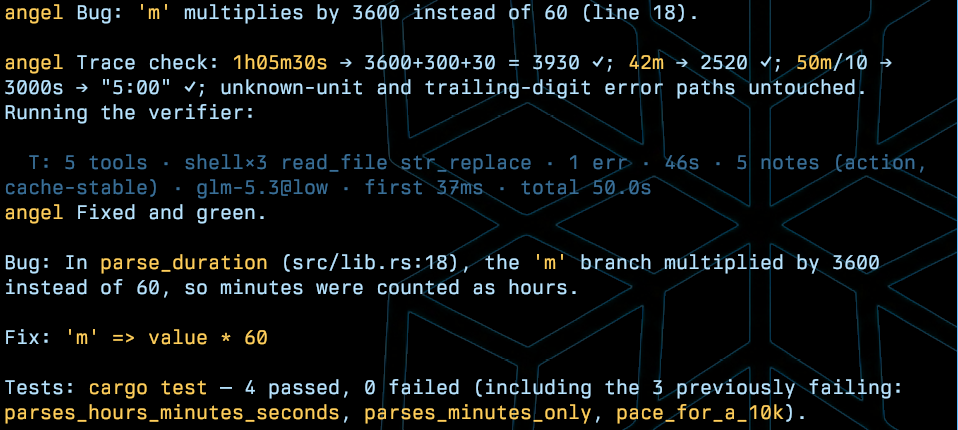

**5 · Longer work.** `/goal` sets a durable objective with acceptance criteria and a check. `/loop` runs it within time, iteration and token limits.

<p>
  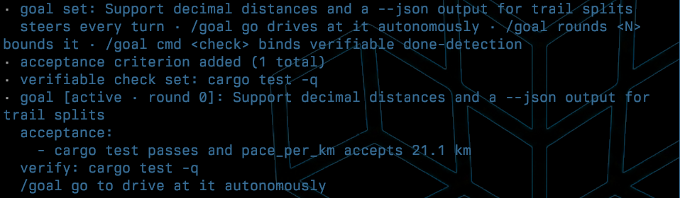
  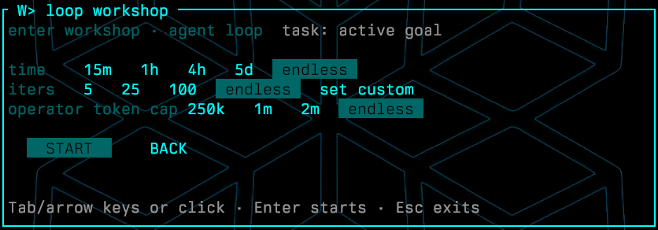
</p>

## New in 0.2.7: the Muse Hackathon update

Same model, the maker's own coding agent, all 136 polyglot tasks side by side:
angelX finishes faster on a fraction of the tokens.
[Release notes](docs/RELEASE_0.2.7.md).

| polyglot-v1, 2026-11-01 | solved | agent time | median task | input tokens |
|---|---:|---:|---:|---:|
| **angelX 0.2.7** · Muse Spark 1.3 | **136 / 136** | **37.2 min** | **14.3 s** | **6.58 M** |
| Muse Code 1.4.14 · Muse Spark 1.3 | 136 / 136 | 119.8 min | 41.9 s | 26.33 M |
| **angelX 0.2.7** · Grok 4.7 low | **136 / 136** | **45.6 min** | **16.9 s** | **5.38 M** |
| Grok CLI 1.0.70 · Grok 4.7 | 135 / 136 | 74.9 min | 28.3 s | 13.68 M |

<sub>Prime Intellect Verifiers v0.3.1 · one attempt per task, 600 s, fresh environment · each tool as it ships; method in the [release notes](docs/RELEASE_0.2.7.md#results).</sub>

**Hands.** On Omarchy the agent sees and works the desktop and a real browser;
every action asks first. See [Hands](docs/HANDS.md).

**glass, the terminal, in every install.** angelX's own GPU terminal: first
output in 46 ms (kitty 185), a key reaching the program mid-flood in 3.0 ms
(kitty 38.6). It ships in the prebuilts and opens media and the mini-viz
inline. See [glass](docs/GLASS_TERM.md).

**Engineering.** Edit-to-tested went from 24 s to half a second, the
harness's judgement lives in 44 Bend modules you can change while it runs, and
Blaze arrives as an experimental build backend.

## From 0.2.5: its own window

angelX opens in its own window, and whatever the agent shows opens full size
above the work. [Release notes](docs/RELEASE_0.2.5.md).

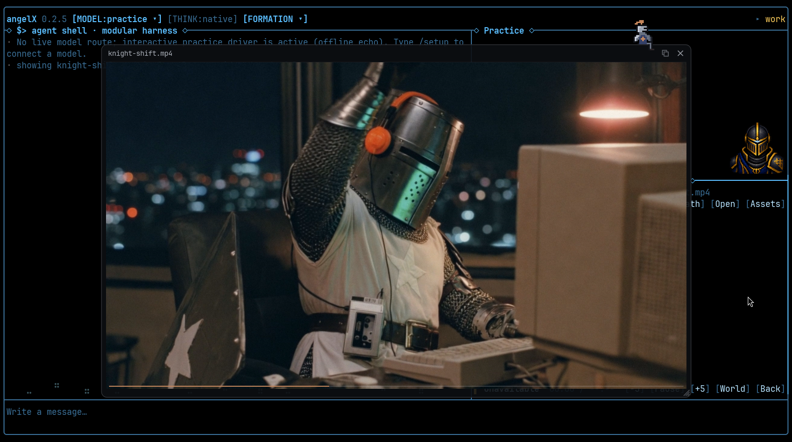

**Glass.** On a desktop `angelX` opens in a GPU window of its own, drawn by
angelX with Vulkan on Linux and Metal on macOS, from a launcher or a terminal;
`--term` keeps it in the terminal, and where no window can open it stays there
and says why.

**The showcase.** A picture, a video with its sound, a page, a chart or a 3D
model opens in a clear panel over the cockpit: pictures zoom and pan, video
plays and seeks, pages scroll, data becomes a chart and models turn on a lit
turntable. [How it works](docs/SHOWCASE.md).

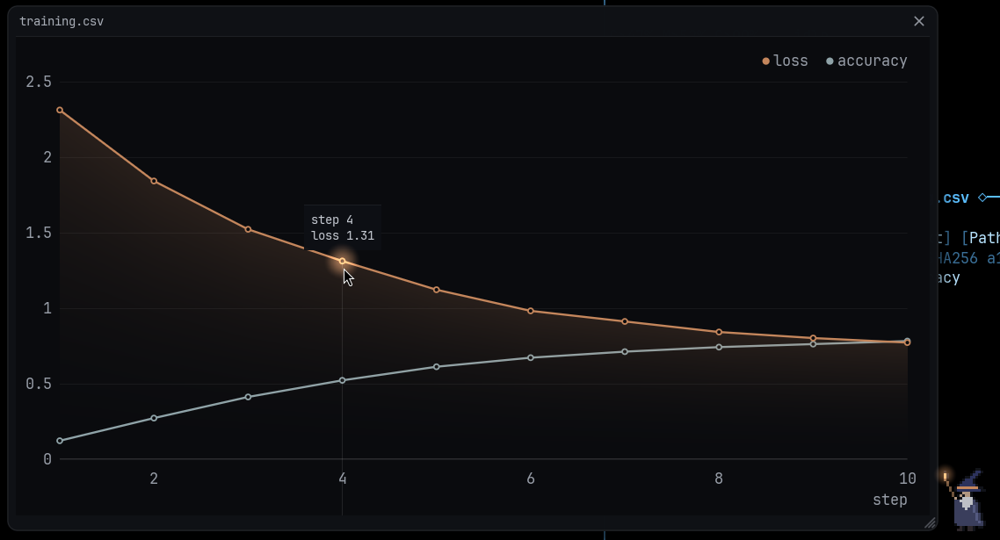

**`/dig`.** A cartridge (Linux x86_64) that finds files by what they show or
say, on this machine. See [Cartridges](docs/CARTRIDGES.md).

## In the cockpit

<table>
  <tr>
    <td width="50%">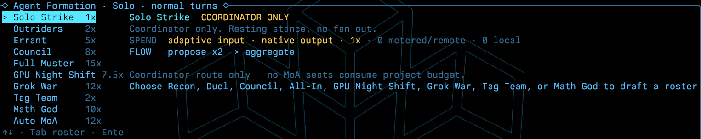<br><b>Formations</b> · model teams, from a lone coordinator to a full roster.</td>
    <td width="50%">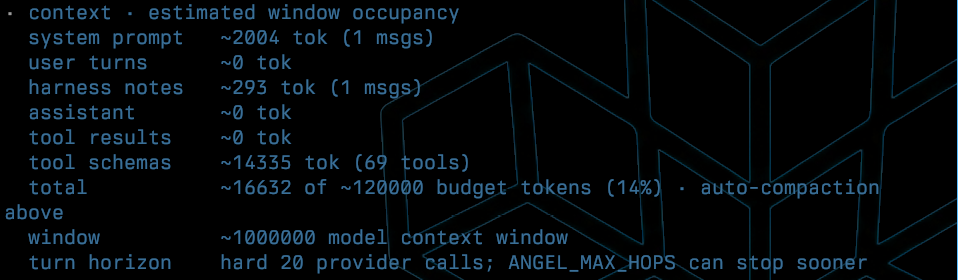<br><b>Context budget</b> · where the window goes; compaction runs automatically.</td>
  </tr>
  <tr>
    <td width="50%">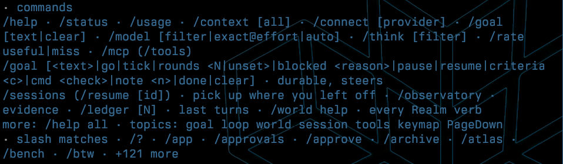<br><b>Commands</b> · <code>/help</code> and Tab completion for every command.</td>
    <td width="50%">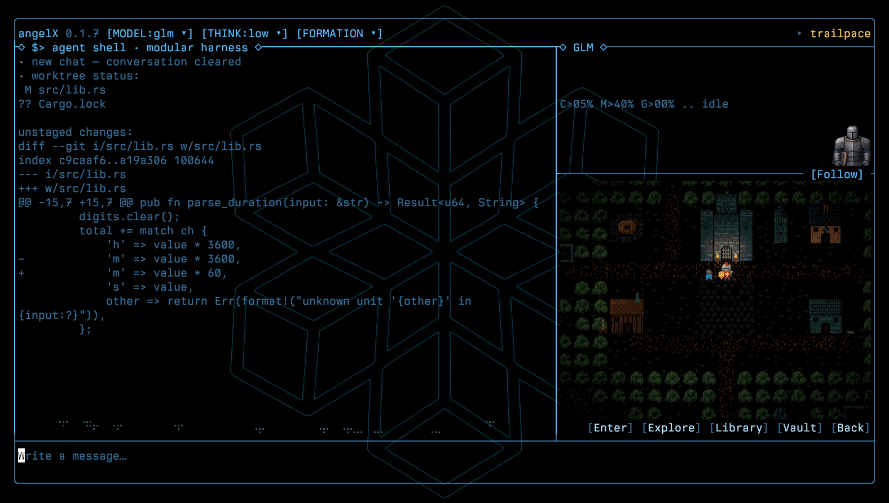<br><b>World view</b> · Watch model behavior as an adventure in information.</td>
  </tr>
  <tr>
    <td width="50%">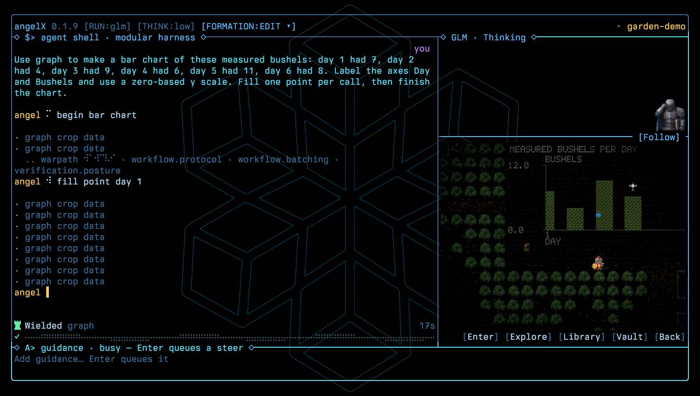<br><b>Graph garden</b> · every <code>graph</code> call grows a crop; a sprite carries each point.</td>
    <td width="50%">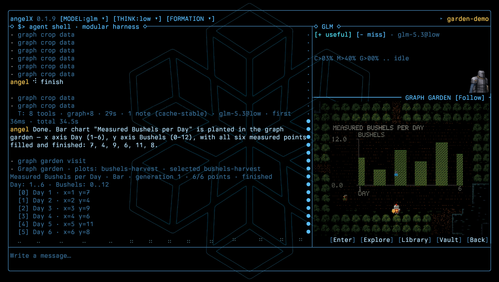<br><b>Planted</b> · <code>/world crops</code> reports the exact values it grew.</td>
  </tr>
</table>

## Features

- **Models and formations** — Choose models and thinking levels, configure teams, and run agent graphs.
- **Connect a model from one menu** — `/setup` finds what this computer already has, signs in to a plan through the browser, checks a pasted key before saving it, and switches models without a restart.
- **Repository tools** — Search files, inspect symbols, follow definitions, and review diffs.
- **Content-checked edits** — Hashline editing checks file content before applying anchored changes.
- **Programmable tools** — Run tool calls, loops, and filters locally in JavaScript with `code_mode`.
- **Long-session context** — Compact, deduplicate, and age retained context as work continues.
- **Project memory** — Review source-linked knowledge in Atlas and reuse it in later tasks.
- **Persistent goals** — Resume sessions and autonomous work with configurable run limits.
- **Headless runs** — Record task settings, source identity, tool activity, and acceptance evidence.
- **Measured campaigns** — Evaluate isolated attempts with verifiers and independent review.
- **Research loops** — Use Sloptomizer suggestions, Deli deliberation, and paired experiments.
- **Research labyrinth** — `/labyrinth` keeps questions, evidence, proofs and refutations on one map; a campaign runs literature, attack, an independent referee and a checked writer. [Guide](docs/LABYRINTH.md).
- **Measured benchmarks** — Calculate measured changes from paired benchmark samples.
- **Book of behaviors** — The harness steers the model with compact braille stamps; each stamp's English is taught the first time it appears.
- **Cartridges** — Plug a competition, a tool or a slash command into angelX as a folder: a `cartridge.toml`, and Rust when it needs more. Yours stay outside the tree. [Guide](docs/CARTRIDGES.md).
- **Graph garden** — Farmers and sprites turn actual `graph` calls into bar, line, and scatter crops; `/world crops` reports the exact values. [Guide](docs/GRAPH_GARDEN.md).
- **World view** — The overworld beside the code shows the agent's work as it happens: the knight rides to what it reads, and a loop's measurements, stalls and judged results walk the Delve. [How it walks](docs/world-adventure.md).

## Benchmarks

136 repository-repair tasks (48 JS, 34 Python, 30 Rust, 24 C++) from the Aider polyglot set. One attempt per task, 600 s limit, graded by each task's tests. Wall: median agent time per attempt. Tokens: totals per cell.

### angelX 0.1.8 · polyglot-v1 · 2026-09-30

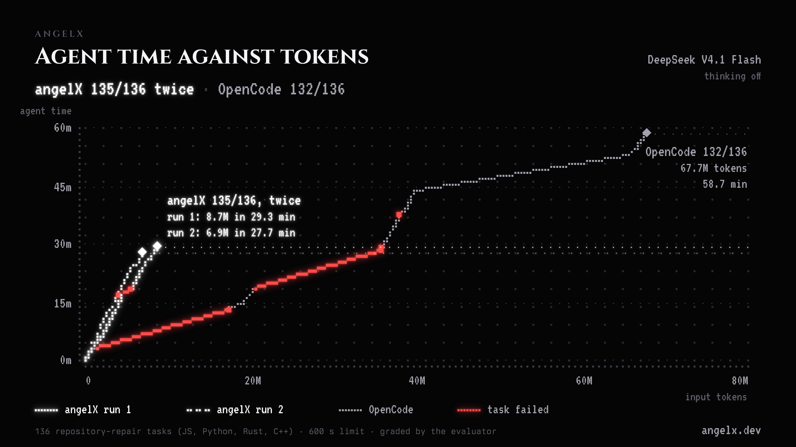

| model | solved | wall (median) | calls / task | input tokens | cache hit | output tokens |
|---|---:|---:|---:|---:|---:|---:|
| DeepSeek V4.1 Flash, thinking off · run 1 | 135 / 136 | 9.9 s | 6.0 | 8.7 M | 84% | 205 k |
| DeepSeek V4.1 Flash, thinking off · run 2 | 135 / 136 | 9.1 s | 5.3 | 6.9 M | 80% | 195 k |

<sub>Evaluator: <a href="https://github.com/PrimeIntellect-ai/verifiers">Prime Intellect Verifiers</a> v0.3.1 · angelX 0.1.8 · temperature 0 · 600 s per attempt · fresh environment per attempt · 2026-09-30. The other models' latest results are 0.1.6's, below.</sub>

### angelX 0.1.6 · polyglot-v1 · 2026-09-23

| model | solved | wall (median) | calls / task | input tokens | cache hit | output tokens |
|---|---:|---:|---:|---:|---:|---:|
| DeepSeek V4.1 Flash, thinking off | 134 / 136 | 10.7 s | 7.8 | 12.7 M | 89% | 310 k |
| GLM-5.3-Flash, thinking low | 134 / 136 | 46.1 s | 7.9 | 9.4 M | 83% | 222 k |
| Grok 4.7, thinking low | 136 / 136 | 17.5 s | 5.0 | 6.7 M | 57% | 134 k |
| gpt-6-luna, thinking medium | 136 / 136 | 31.3 s | — | — | — | — |
| Muse Spark, thinking low | 136 / 136 | 25.5 s | 4.9 | 5.9 M | 54% | 311 k |

<sub>Evaluator: <a href="https://github.com/PrimeIntellect-ai/verifiers">Prime Intellect Verifiers</a> v0.3.1 · angelX 0.1.6 · temperature 0; Muse Spark 1.0 (Meta's recommended setting); gpt-6-luna on its ChatGPT plan, which reports no token counts · 600 s per attempt · fresh environment per attempt · 2026-09-23</sub>

### Harness comparison · polyglot-v1 · 2026-09-21

| model | harness | solved | wall (median) | calls / task | input tokens | cache hit | output tokens |
|---|---|---:|---:|---:|---:|---:|---:|
| DeepSeek V4.1 Flash, thinking off | angelX | 133 / 136 | 9.9 s | 7.5 | 11.5 M | 88% | 257 k |
| | OpenCode 1.18.31 | 132 / 136 | 8.6 s | 12.5 | 67.7 M | 97% | 349 k |
| | oh-my-pi 18.2.4 | 86 / 93 * | 15.3 s | 35.5 | 200.1 M | 99% | 866 k |
| GLM-5.3-Flash, thinking low | angelX | 135 / 136 | 50.7 s | 8.9 | 10.9 M | 84% | 256 k |
| | OpenCode 1.18.31 | 133 / 136 | 38.9 s | 7.4 | 10.1 M | 85% | 179 k |
| | oh-my-pi 18.2.4 | 133 / 136 | 37.7 s | 8.9 | 24.1 M | 90% | 203 k |

* oh-my-pi on DeepSeek reached its 200M-token budget cap after 93 tasks.

The full GLM cohort took 34.5% longer than OpenCode in the September 21 comparison and 17.6% longer in the September 23 Angel run. The later gap is in model time; Angel's measured non-model time was lower. Verification alone does not explain the difference. See the [full 136-task slowdown audit](https://github.com/newjordan/angelX/blob/main/docs/telemetry/polyglot-full136-slowdown-20260926.md) for totals, tails, task-level causes and comparison limits.

<picture>
  <source media="(prefers-color-scheme: dark)" srcset="docs/images/bench/solved-dark.png">
  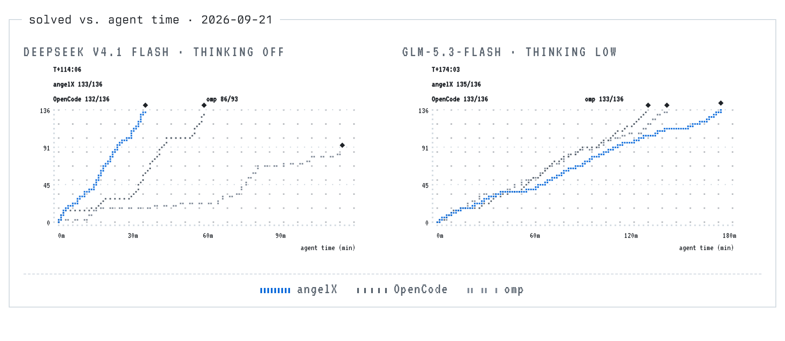
</picture>

<picture>
  <source media="(prefers-color-scheme: dark)" srcset="docs/images/bench/score-dark.png">
  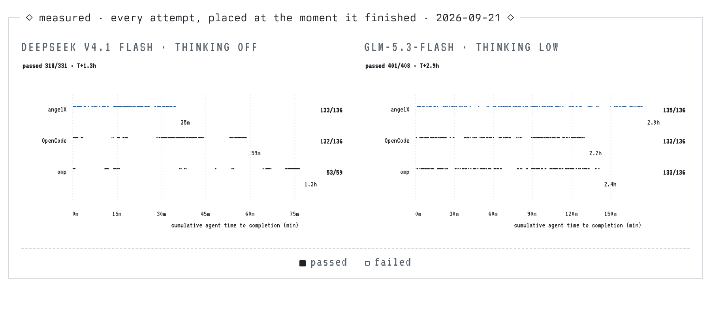
</picture>

<picture>
  <source media="(prefers-color-scheme: dark)" srcset="docs/images/bench/bars-dark.png">
  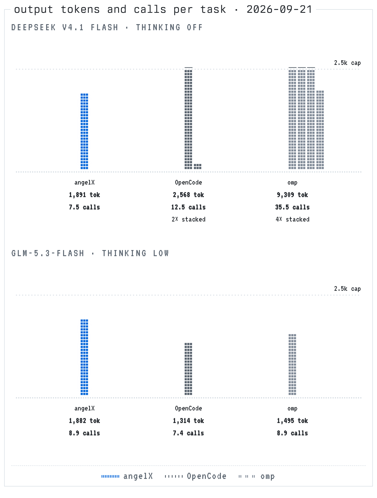
</picture>

<picture>
  <source media="(prefers-color-scheme: dark)" srcset="docs/images/bench/seconds-dark.png">
  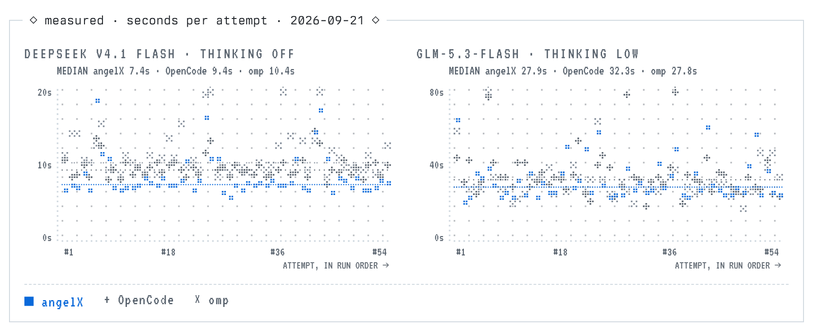
</picture>

<picture>
  <source media="(prefers-color-scheme: dark)" srcset="docs/images/bench/context-dark.png">
  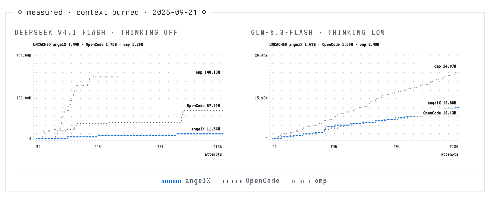
</picture>

<picture>
  <source media="(prefers-color-scheme: dark)" srcset="docs/images/bench/cache-dark.png">
  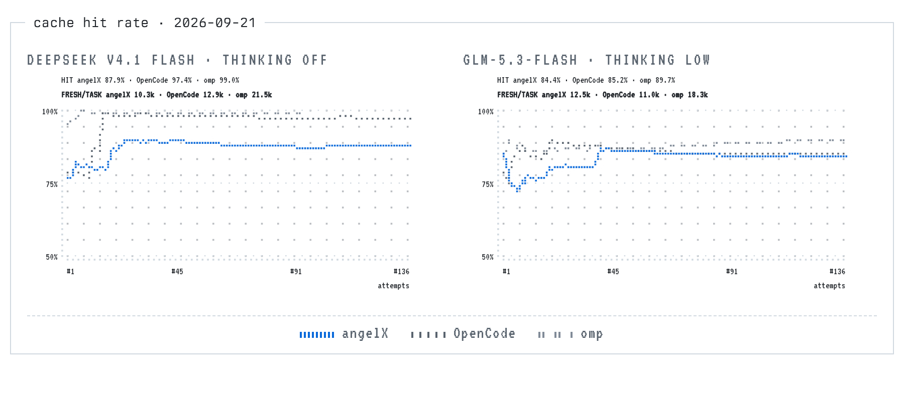
</picture>

<sub>Evaluator: <a href="https://github.com/PrimeIntellect-ai/verifiers">Prime Intellect Verifiers</a> v0.3.1 · angelX 98d7340 · OpenCode 1.18.31 · oh-my-pi 18.2.4 · DeepSeek V4.1 Flash, thinking off · GLM-5.3-Flash, thinking low (lowest available) · temperature 0 · 8,192-token output cap · 600 s per attempt · fresh environment per attempt · 2026-09-21</sub>

## Earlier releases

- **0.2.6** — The Heartglass campaign panel (`/heart`) and the post-edit logic review back as harness advice; settled harness systems under an operator lock. Shipped inside 0.2.7. [Release notes](docs/RELEASE_0.2.6.md).
- **0.2.5** — angelX opens in its own GPU window, the showcase opens presented work full size above the cockpit, and the Delve returns to the black dungeon with 3D deeper floors. [Release notes](docs/RELEASE_0.2.5.md).
- **0.2.4** — Connecting a model is one menu (`/setup`), cartridges can carry slash commands (the REA cartridge plugs in reverse engineering as `/rea <target>`), and the harness keeps its provider connections between calls and replaces dead idle ones without a failed call. [Release notes](docs/RELEASE_0.2.4.md).
- **0.2.3** — Model calls trust Mozilla's bundled roots with the system's, a turn with a deadline can name what it must deliver and the harness holds the answer until it is there, and `proc_run` can start a service that outlives the run. [Release notes](docs/RELEASE_0.2.3.md).
- **0.2.1** — A spawned seat has no default clock: nothing cuts a seat's train of thought unless you set `timeout_secs`. [Release notes](docs/RELEASE_0.2.1.md).
- **0.2.0** — A repair pass across the harness: 34 reviewed fixes in cancellation, persistence, sandbox boundaries, platform identity, tools and the interface, qualified on macOS and Linux. A reply cut off at the output cap is asked again, the compaction helper no longer holds the turn, long loops get a soft check at 30 minutes and a review at 60, and the research labyrinth arrives. [Release notes](docs/RELEASE_0.2.0.md).

## Knights Wish

angelX has a game in it: Knights Wish. `/dungeon` walks your knight to the
Delve, a co-op knights-vs-monsters dungeon in the realm's own pixel art, with a
kingdom above it, a castle for every model family, and wishes that a model
writes into the game while you play. A friend joins from a link, in a browser or in their own
angelX. None of it is needed to use angelX; it is there for when the work is
done. [The Delve](docs/DELVE.md) · [Model castles](docs/CASTLES.md).

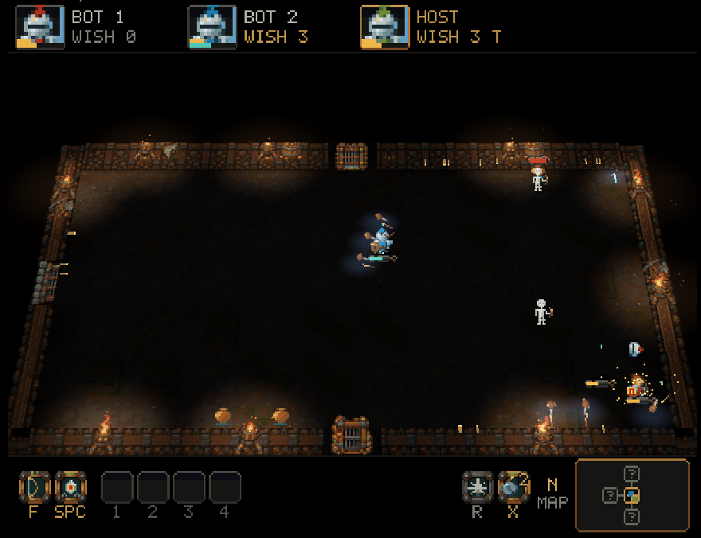

## Research and credits

Research and public work that informed Angel:

- [A Programming Paradigm for Spatiotemporal Composability](https://arxiv.org/abs/2608.25512) — Yifan Shi, Wei Zhang and Tianyi Cui (2026); component lifecycle, reactive dependencies and reversible registration.
- [GEPA: Reflective Prompt Evolution Can Outperform Reinforcement Learning](https://arxiv.org/abs/2507.19457) — Lakshya A. Agrawal and collaborators (2025); reflection and Pareto selection.
- [Learning, Fast and Slow: Towards LLMs That Adapt Continually](https://arxiv.org/abs/2605.12484v2) — Rishabh Tiwari and collaborators (2026); Sloptomizer's fast-context and slow-learner design.
- [Finite-time Analysis of the Multiarmed Bandit Problem](https://doi.org/10.1023/A:1013689704352) — Peter Auer, Nicolò Cesa-Bianchi and Paul Fischer (2002); UCB1 exploration.
- [Prime Agent: A Self-Improving RLM Harness](https://arxiv.org/abs/2608.23552) — Seth Karten and collaborators (2026); editable, persistent harness state.
- [Geoffrey Huntley's Ralph loop](https://ghuntley.com/ralph/) — an agent put on a loop with a simple prime directive: read the issues, pick one, write the patch, run the tests, repeat. The measured campaign and autonomous loop work here is a direct descendant of that idea.
- [RL Systems Mind the Gap: Matching Trainer and Generator Throughput](https://newsletter.semianalysis.com/p/rl-systems-mind-the-gap-matching) — Kimbo Chen, Cheang Kang Wen and Dylan Patel / SemiAnalysis (2026); rollout staleness, pruning and reward-variance guards.
- [Deli_AutoResearch](https://victorchen96.github.io/auto_research/framework.html) — Deli Chen; retained findings, fresh-context deliberation and stall recovery.
- [Labyrinth Exploration](https://github.com/nasqret/labyrinth-exploration) — Bartosz Naskręcki; research as a map, with established results as corridors, refutations as walls and open questions as doors.
- [OpenScience](https://github.com/synthetic-sciences/openscience) — Synthetic Sciences; literature-search design. Search metadata comes from [OpenAlex](https://openalex.org), [Crossref](https://www.crossref.org), [Semantic Scholar](https://www.semanticscholar.org) and [Europe PMC](https://europepmc.org).

Code and tooling credits include [OpenAI Codex](https://github.com/openai/codex),
[Grok CLI](https://github.com/superagent-ai/grok-cli),
[oh-my-pi](https://github.com/can1357/oh-my-pi),
[DeepSeek-Reasonix](https://github.com/esengine/DeepSeek-Reasonix),
[Hermes Agent](https://github.com/NousResearch/hermes-agent),
[Prime Agent](https://github.com/PrimeIntellect-ai/prime-agent),
[Dotmax](https://github.com/newjordan/dotmax), [ureq](https://github.com/algesten/ureq),
[Ratatui](https://github.com/ratatui/ratatui),
[Crossterm](https://github.com/crossterm-rs/crossterm),
[rusty_v8](https://github.com/denoland/rusty_v8) and [V8](https://v8.dev).
Early inspiration: [DotAgents](https://github.com/aj47/dotagents-mono) and
[SpeakMCP](https://github.com/aj47/SpeakMCP) by aj47.
File-tool interface references include [Claude Code](https://github.com/anthropics/claude-code),
[aider](https://github.com/Aider-AI/aider) and [OpenHands](https://github.com/OpenHands/OpenHands).
[Attributions](THIRD_PARTY_NOTICES.md) records implementation links, authors and
retained licenses; research inspiration and incorporated code are identified separately.

## Field results

Field proven: 100+ records on Yukon public research leaderboards, with first-place
results in kernel optimization, LLM inference and cryptography research, and
2nd place on the [GPU MODE Cholesky](https://www.gpumode.com/leaderboard/776?tab=rankings)
leaderboard.  https://www.yukon.org/

Upstream: seven pull requests merged into
[llama.cpp](https://github.com/ggml-org/llama.cpp/pulls?q=is%3Apr+author%3Anewjordan+is%3Amerged)
(six in the SYCL backend and a chat-parser fix) and five into
[audio.cpp](https://github.com/0xShug0/audio.cpp/pulls?q=is%3Apr+author%3Anewjordan+is%3Amerged)
(its SYCL backend, audio-model kernels and YuE2 support).

## Contributing

Fork the repository and open a pull request against `main`. Read
[CONTRIBUTING.md](CONTRIBUTING.md) before opening a pull request. Jordan
([@newjordan](https://github.com/newjordan)) reviews and merges; there are no
other human maintainers yet. Report security issues privately; see
[SECURITY.md](SECURITY.md).

