<p align="center">
  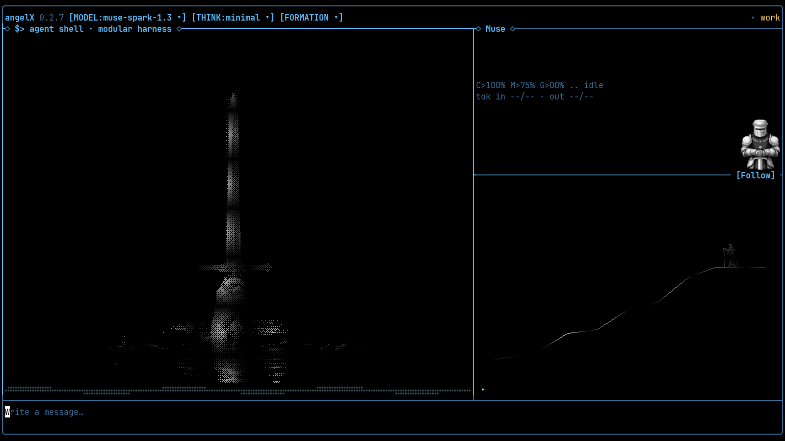
</p>

<h1 align="center">angelX</h1>

<p align="center">
  A terminal coding agent that runs on the models you already have,<br>
  asks before it acts, and checks its work before it says done.
</p>

<p align="center">
  <a href="https://omni-space.tech">Website</a> ·
  <a href="#install">Install</a> ·
  <a href="#how-it-works">How it works</a> ·
  <a href="docs/MODELS.md">Models</a> ·
  <a href="docs/COMMANDS.md">Commands</a> ·
  <a href="https://github.com/newjordan/angelX/releases">Releases</a>
</p>

---

https://github.com/user-attachments/assets/53be0360-3b4d-4176-ac7b-c924c101c927

**[Download the full-quality film](https://github.com/newjordan/angelX/releases/download/v0.2.7/angelX-how-to-use.mp4)** (2:47, MP4): install, connect a model, set a goal and run a loop.

angelX works inside your repository with any model you choose: a local server
such as Ollama, LM Studio, llama.cpp or vLLM, a ChatGPT or Grok plan, or an API
key from OpenAI, Anthropic, DeepSeek, xAI, Z.ai or OpenRouter. Every command
and edit arrives for your approval before it runs. Before it reports done, it
runs your checks and shows the receipts. What it learns about your project
stays for the next session.

## Install

```sh
curl -fsSL https://raw.githubusercontent.com/newjordan/angelX/main/install.sh | sh
```

Open a new terminal window, then:

```sh
cd your-project && angelX
```

Prebuilt for Linux x86_64 and arm64 (glibc 2.31 or newer) and macOS on Apple
silicon. The first launch opens a setup menu that finds the models already on
this machine, checks a pasted API key, or signs in to a ChatGPT or Grok plan
through your browser. `/setup` changes it later, and `angelX update` installs
the latest release.

Every install also ships **glass**, angelX's own GPU terminal, linked as
`glass` beside `angelX`. Run angelX inside glass and pictures, video and charts
show in the terminal too.

<details>
<summary><b>Build from source</b></summary>

You need Rust/Cargo, C/C++ tools, Bash, Node.js and Python 3. On macOS run
`xcode-select --install`, then install Rust from https://rustup.rs.

```sh
git clone https://github.com/newjordan/angelX.git
cd angelX
./bin/angelX
```

See the [development workflow](CONTRIBUTING.md#setup).

</details>

## Why angelX

**Your models, your choice.** Connect a local server, a plan login or an API
key from one menu. `/model` switches routes without a restart, `/think` sets
the reasoning level, and formations put several models on one task.

**Approval before action.** Commands and edits arrive as action capsules.
Approve one, approve the rest of the turn, or deny. Each edit is anchored to
the file's current content and shows its byte change before it lands.

**Checked before done.** The agent runs your checks and reports with receipts:
every tool call, its time and the model route.

**Less of the model's time.** The prompt cache keeps hitting, context is
compacted as the session grows, and the harness steers the model with compact
stamps instead of paragraphs. The same work takes fewer tokens.

**Work that outlasts the session.** `/goal` sets a durable objective with
acceptance criteria and a check. `/loop` runs it within time, iteration and
token limits. Sessions resume where they stopped.

**A window of its own.** On a desktop, angelX opens in a GPU window. Whatever
the agent shows you opens full size above the work: pictures, video, pages,
charts and 3D models. `--term` keeps it in the terminal.

## How it works

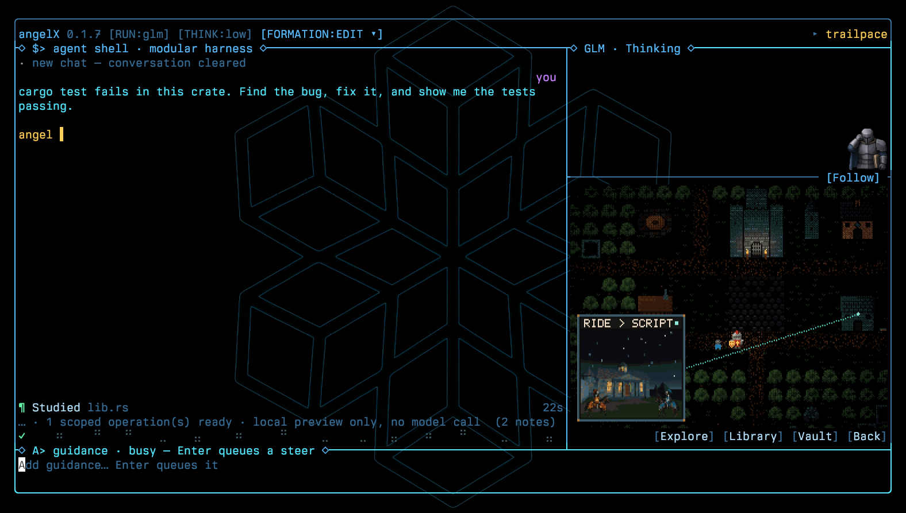

**1 · Choose a model.** `/model` lists every connected route with its thinking level; `/think` changes the level.

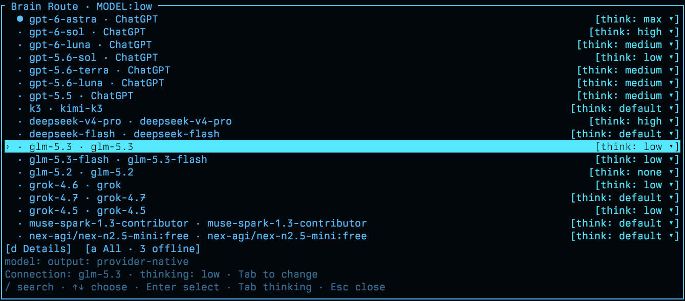

**2 · Approve what it does.** Commands and edits arrive as action capsules: approve one (`y`), approve the rest of the turn (`a`), or deny (`n`).

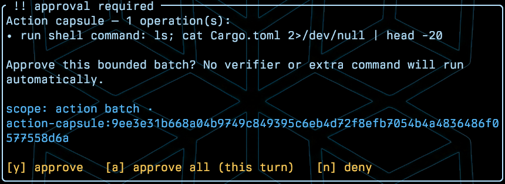

**3 · Content-checked edits.** Each edit is anchored to the file's current content and shows its byte change before it lands. `/diff` shows the result.

<p>
  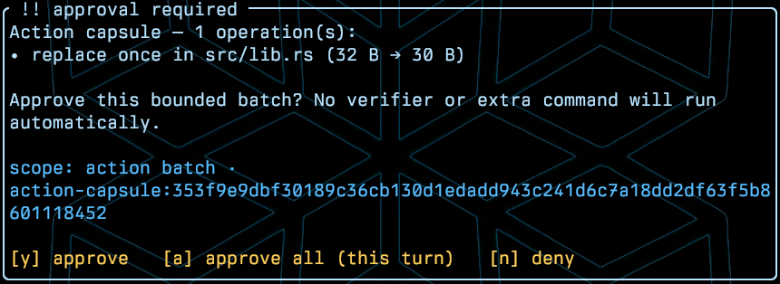
  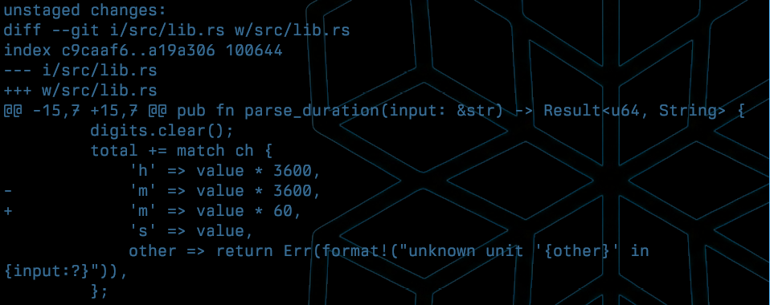
</p>

**4 · Checked before done.** The agent runs the checks and reports with receipts: every tool call, its time and the model route.

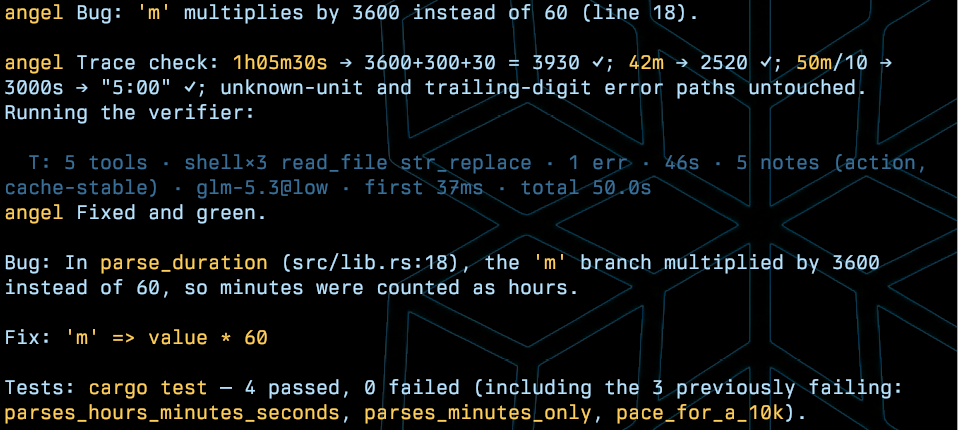

**5 · Longer work.** `/goal` sets a durable objective with acceptance criteria and a check. `/loop` runs it within time, iteration and token limits.

<p>
  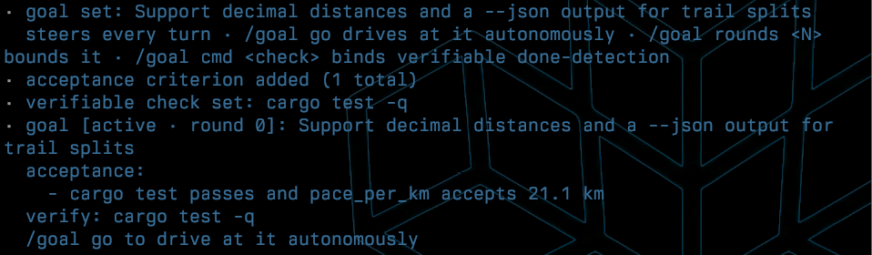
  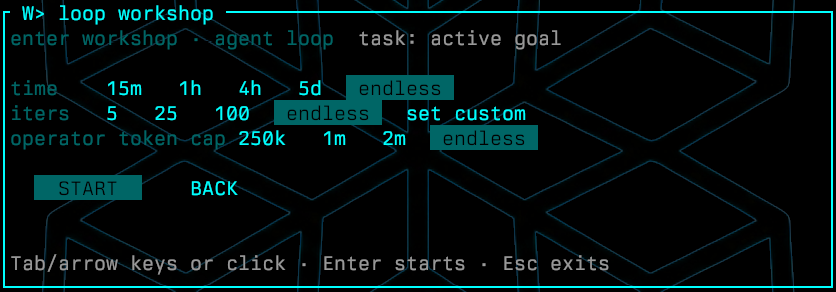
</p>

## In the cockpit

<table>
  <tr>
    <td width="50%">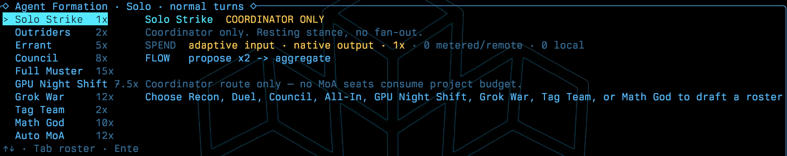<br><b>Formations</b> · model teams, from a lone coordinator to a full roster.</td>
    <td width="50%">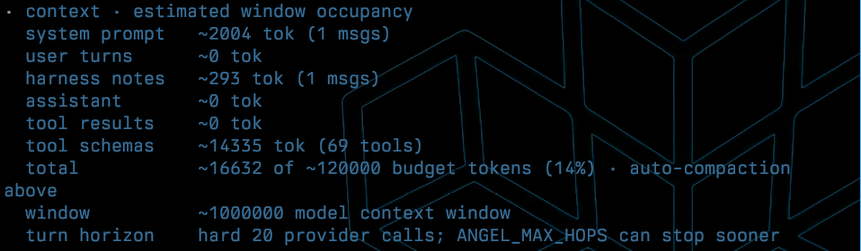<br><b>Context budget</b> · where the window goes; compaction runs automatically.</td>
  </tr>
  <tr>
    <td width="50%">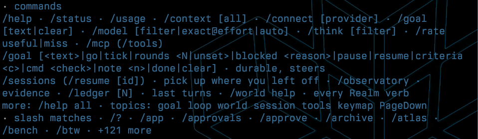<br><b>Commands</b> · <code>/help</code> and Tab completion for every command.</td>
    <td width="50%">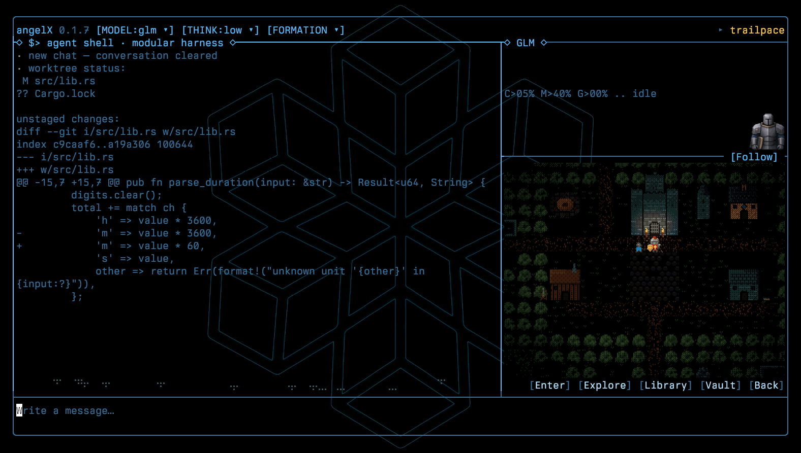<br><b>World view</b> · the agent's work as it happens, drawn as a journey beside the code.</td>
  </tr>
  <tr>
    <td width="50%">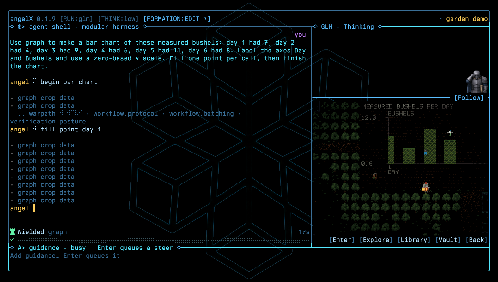<br><b>Graph garden</b> · every <code>graph</code> call grows a crop; a sprite carries each point.</td>
    <td width="50%">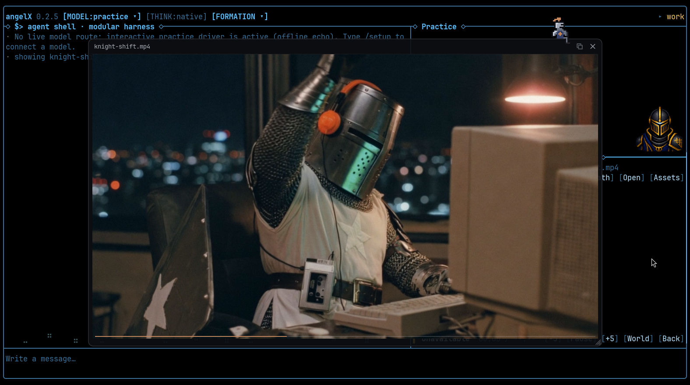<br><b>The showcase</b> · whatever the agent presents opens full size above the work.</td>
  </tr>
</table>

## Knights Wish

angelX has a game in it. `/dungeon` walks your knight to the Delve, a co-op
knights-versus-monsters dungeon in the realm's own pixel art, with a kingdom
above it, a castle for every model family, and wishes that a model writes into
the game while you play. A friend joins from a link. None of it is needed to
use angelX; it is there for when the work is done. [The Delve](docs/DELVE.md).

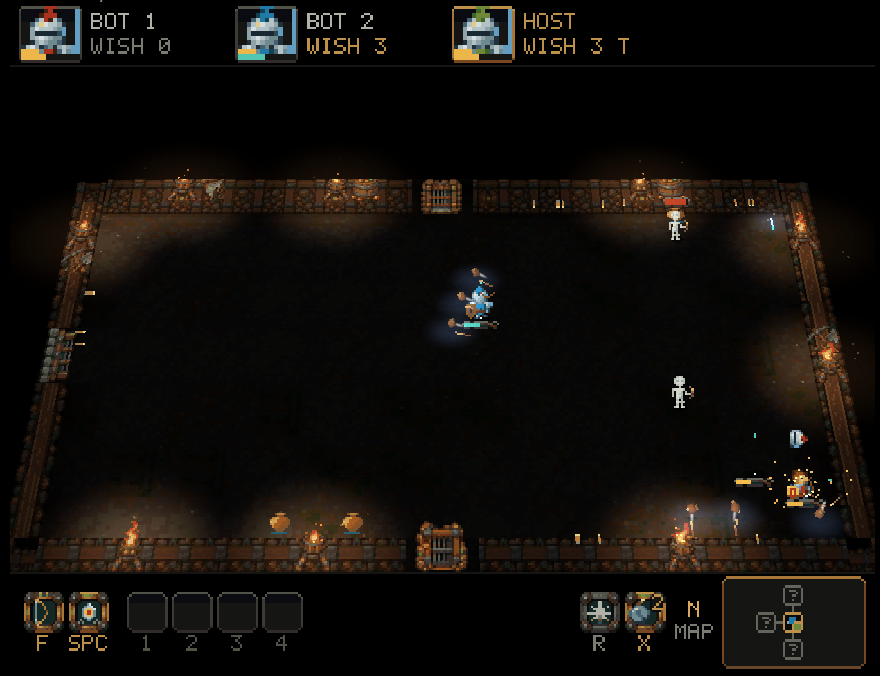

## More

[Model setup](docs/MODELS.md) · [Commands](docs/COMMANDS.md) ·
[glass](docs/GLASS_TERM.md) · [Hands](docs/HANDS.md) ·
[Cartridges](docs/CARTRIDGES.md) · [Plugins](docs/PLUGINS.md) ·
[Release notes](docs/RELEASE_0.2.86.md) ·
[Attributions](THIRD_PARTY_NOTICES.md) · [Contributing](CONTRIBUTING.md) ·
[Security](SECURITY.md) · [MIT](LICENSE)

Fork the repository and open a pull request against `main`. Jordan
([@newjordan](https://github.com/newjordan)) reviews and merges. Report
security issues privately; see [SECURITY.md](SECURITY.md).
