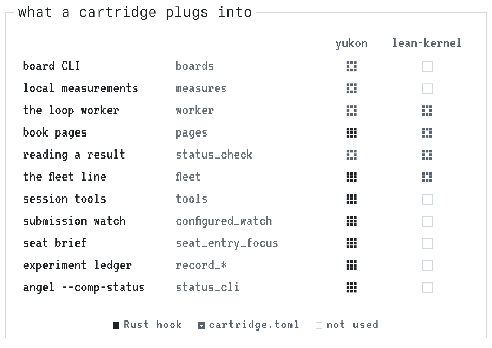
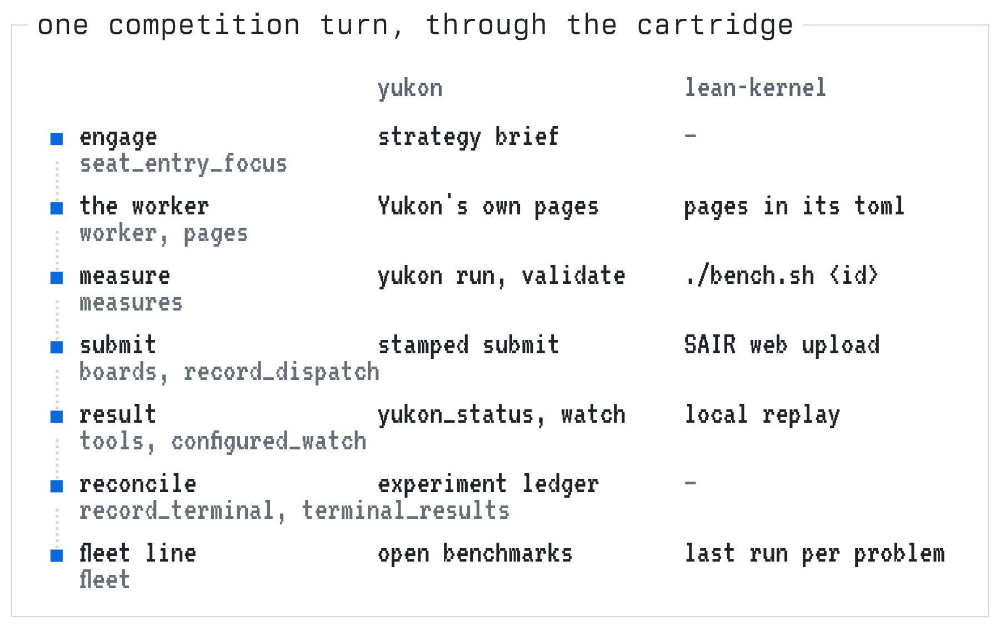
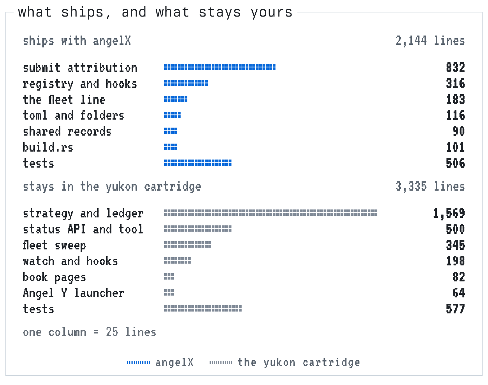

# Cartridges

angelX ships the competition engine: the loop, the submission watcher, the
fleet line on the loop HUD, truthful `--model`/`--harness` attribution on board
submissions, and the book of behaviors. A **cartridge** plugs one competition
into that engine: its board CLI, its loop worker's brief, its status API, its
book pages. Cartridges are yours. They live outside the angelX tree, so a
private setup never ships with the harness.

<picture>
  <source media="(prefers-color-scheme: dark)" srcset="images/cartridges/slot-dark.png">
  
</picture>

A config-only cartridge published in the registry is a **plugin**: anyone can
install it with `/plugins install <id>` and publish their own with
`angelX plugin submit`. See [Plugins](PLUGINS.md).

## Plugging one in

Put the cartridge's folder in `~/.angelX/cartridges/`, or point
`ANGEL_CARTRIDGES` at it (a path list; each entry is a cartridge or a folder of
them). The first cartridge found is active; `ANGEL_CARTRIDGE=<id>` picks
another. `angel --build-info --json` lists the cartridges a binary carries.

With no cartridge plugged in, the engine runs on its own: competition loops,
the watcher and the HUD work, and the book names only the platform CLI.

## How Yukon uses it

Yukon is the operator's own cartridge, and the reason the slot exists. It is a
source cartridge: a `cartridge.toml` plus Rust that the build compiles in. It
lives in `~/.angelX/cartridges/yukon`, a private repository of its own, and
none of it is in this tree.

- **The toml** names the board CLI (`yukon`, installed as `hilbert` too), the
  local measurements (`yukon run`, `yukon validate`), the worker's page, and how
  a result is read (`yukon_status or the platform CLI`).
- **The Rust** adds the `yukon_status` tool, the authenticated status API behind
  a live submission watch, the fleet sweep across every open benchmark, the
  seat's strategy brief and its experiment ledger, `angel --comp-status`, and
  the book pages that name all of it, in the words they had before cartridges.
  A golden test holds those pages to the old text.
- **Angel Y**, the pinned competition launcher, ships inside the cartridge and
  refuses a binary built without it.

Every turn of a Yukon loop passes through the cartridge at seven points:

<picture>
  <source media="(prefers-color-scheme: dark)" srcset="images/cartridges/turn-dark.png">
  
</picture>

What the split moved, measured in lines (data in
[`cartridges.json`](images/cartridges/cartridges.json)):

<picture>
  <source media="(prefers-color-scheme: dark)" srcset="images/cartridges/lines-dark.png">
  
</picture>

## Another competition: the Lean Kernel Challenge

[The Lean Kernel Challenge](https://competition.sair.foundation/competitions/lean-kernel-challenge)
(Lean FRO and the SAIR Foundation; submissions close 2026-11-20) asks for
verified computation: for each problem, an algorithm `impl` and a proof
`impl_correct` that it matches the specification for every input. The rank is
the sum of per-case median kernel instruction counts, lowest first.

[`examples/cartridges/lean-kernel`](examples/cartridges/lean-kernel/) is that
competition as a config-only cartridge, written from its public rules and
starter repository. It has not been run on the live challenge.

- **No board to stamp.** Submissions go through the SAIR web platform, so
  `boards` is empty.
- **The worker's pages are data.** `[[pages]]` in the toml give the loop worker
  its brief at `⠻⠊`, the same address Yukon's Rust pages use.
- **Measuring.** `bench.sh` proves a candidate with `lake build`, then replays
  it in the kernel with the challenge's `evaluation/run.py`. angelX already
  counts a `bench*` script as a measurement.
- **The fleet line.** `fleet.sh` reads each problem's latest local evaluation.
- **When to add Rust.** To read the official leaderboard, watch a submission, or
  keep an instruction-count ledger, the cartridge would grow a `src/` with
  those hooks, as Yukon's did.

## A tool cartridge: REA

A cartridge can also carry slash commands instead of a competition. Each
`[[commands]]` entry names a word and a stack of skills from the cartridge's
`skills/` folder. `/<word> <task>` sends one turn with those skills and the
task, as `/skills` would. Until then the cartridge costs nothing: no process
starts, no tool joins the registry, and its skills stay out of the catalog. A
cartridge with commands and no board or worker is never the active competition.
In a skill, `${ANGEL_CARTRIDGE_DIR}` becomes the cartridge's folder.

It can carry tools too. Each `[[tools]]` entry names a program in the
cartridge's folder, a description and a JSON schema for its arguments. The tool
joins every session deferred, so its schema costs nothing until `tool_search`
brings it in. A call runs the program in the session's workspace with the
call's arguments as JSON on stdin, `ANGEL_CARTRIDGE_DIR` and `ANGEL_WORKSPACE`
set; its stdout is the result, and a failing exit is an error with the end of
its stderr. A name another tool already has keeps that tool. `core = true`
advertises the tool with the core coding tools instead, beside `grep`, at the
cost of its schema on every request.

[`examples/cartridges/rea`](examples/cartridges/rea/) plugs in
[REA](https://github.com/morluto/rea) (Reverse Engineer Anything, MIT), which
reverse engineers native binaries, JavaScript/Electron apps, .NET assemblies,
APKs, firmware and websites. REA's MCP server has 207 tools with 3.3 MB of
schema. Attached through `mcp.json`, every turn would carry them, so the
cartridge drives REA's CLI instead.

```sh
docs/examples/cartridges/rea/install.sh   # into ~/.angelX/cartridges/rea
```

The install pins `rea-agents` (6.5.0; `REA_VERSION` picks another release) and
takes REA's skill from that package, so the skill matches the CLI. Then:

```text
/rea /usr/lib/obsidian/app.asar how does search work? build a version here
```

The turn carries the cartridge's `rea` skill (where the CLI is, and how REA's
tool names map to its commands), then REA's own `reverse-engineer-anything`.
Remove `~/.angelX/cartridges/rea` to unplug it. Native decompilation needs
Ghidra, IDA or Hopper; the other targets need none.

### DigUp

[`examples/cartridges/dig`](examples/cartridges/dig/) plugs in
[DigUp](https://github.com/ARahim3/DigUp) (MIT), which finds files by what
they show or say: pictures, PDFs, documents, recordings and video, and code in
the folders added for it. It runs Google DeepMind's EmbeddingGemma 2 on
llama.cpp, on this machine, and keeps one SQLite index of vectors and exact
words. A hit names the page, the second or the line.

```sh
DIG_HOME=~/digup docs/examples/cartridges/dig/install.sh   # into ~/.angelX/cartridges/dig
~/.angelX/cartridges/dig/bin/digup estimate ~/Pictures         # the first pass's time
~/.angelX/cartridges/dig/bin/digup index ~/Pictures            # adds the folder; again to catch up
```

The install pins DigUp's Linux x86_64 release (0.7.0-beta.2, checked by its
SHA-256), takes its command-line helper from the package and fetches the model
(865 MB, once). `DIG_HOME`, optional, keeps the helper, model and index
outside the cartridge. Then:

```text
/dig the knight sheet with the lance first
```

The turn carries the cartridge's `dig` skill (where the CLI is, what a hit
says, how to add a folder) and searches the index built ahead of time.

While coding, the agent has `dig_search` (`bin/dig-search`), a core tool beside
`grep`. It
searches the workspace's code by what it does or a name in it and answers
`path:line`; a worktree of an indexed checkout is served from that checkout's
index, its hits mapped onto the worktree's files. With `kinds`, it searches
those kinds of file in every indexed folder instead. Index a repository's code
with `digup index --code <repo>`. Nothing watches the folders; re-running
`digup index` on a schedule (a systemd timer, say) keeps the index current, and
an unchanged repository costs seconds. Remove `~/.angelX/cartridges/dig` to
unplug it.

### Bend Pixel VFX

[`examples/cartridges/vfx`](examples/cartridges/vfx/) carries a local pixel VFX
renderer written in Bend 2, with a Node adapter for PNG sheets, GIFs, atlas JSON,
Godot SpriteFrames and ZIP exports. It is an independent MIT implementation;
it uses no Scenario source, accounts or paid generation.

```sh
docs/examples/cartridges/vfx/install.sh   # into ~/.angelX/cartridges/vfx
```

After restarting angelX, `/vfx <effect>` loads its authoring skill, and the
deferred `vfx_catalog` and `vfx_render` tools list and render effects. The same
adapter also exposes stdio MCP (`bin/vfx mcp`) and a loopback HTTP API
(`bin/vfx serve`). The cartridge's README documents the recipe format, pinned
toolchain, output limits and interface examples.

## A config-only cartridge

A folder holding one `cartridge.toml` is a whole cartridge. It is read at
startup; nothing is rebuilt.

```toml
id = "kernelbench"
label = "KernelBench"
# The board CLI's program names. `<board> submit` gets angelX's own --model and
# --harness; `<board> submit|submissions|status|list` count as outcomes.
boards = ["kb"]
# `<board> <sub>` commands that are local measurements.
measures = ["run", "validate"]
# The loop worker's brief: a page address, defined below.
worker = "⠻⠊"
# How the prompts name reading a submission's result.
status_check = "`kb status` or the platform CLI"
# The fleet line: a command printing one snapshot. It runs in the session's
# directory; ANGEL_CARTRIDGE_DIR names this folder.
fleet_command = "\"$ANGEL_CARTRIDGE_DIR/fleet.sh\""
fleet_interval_secs = 45

[[pages]]
route = "⠻⠊"
name = "kernelbench"
signal = "the KernelBench loop worker"
pages = ["You are a competition loop worker on KernelBench."]

# A slash command: `/kb <task>` sends one turn with skills/kb-triage.
[[commands]]
name = "kb"
usage = "<kernel> [what to try]"
skills = ["kb-triage"]

# A deferred tool: bin/kb-best reads the call's JSON on stdin and prints the
# result. `params` is the arguments' JSON schema.
[[tools]]
name = "kb_best"
description = "The best local score for a kernel so far"
run = "bin/kb-best"
params = { type = "object", required = ["kernel"], properties = { kernel = { type = "string" } } }
```

`fleet_command` prints:

```json
{"benchmarks": 2, "failed": 0,
 "submissions": [{"benchmark": "kb/softmax", "id": "a1b2", "status": "validating", "score": null}]}
```

## A source cartridge

Add `src/mod.rs` beside the toml and the cockpit's build compiles the folder
in as a module. It exports `pub(crate) static HOOKS`, an implementation of
`Hooks` (`cockpit/src/agent/harness/cartridges/mod.rs`). Every hook is
optional:

| Hook | What it gives the competition |
|---|---|
| `tools` | Tools added to every session (a status reader, say) |
| `research_tools` | Which of those long research always sees |
| `pages` | Book pages: new routes, or the competition's own wording of a route |
| `configured_watch` | A live submission watch the operator configures |
| `fleet_sweep` | The fleet line, in Rust |
| `seat_entry_focus` | Evidence carried inline when a competition turn engages |
| `record_dispatch`, `record_terminal`, `terminal_results` | A durable experiment ledger the loop reconciles against |
| `status_cli` | `angel --comp-status ARGS…` |

A source cartridge can use anything in the cockpit crate. Rebuild after
changing it; Rust tracks the source modules and included files it compiles.
Only cartridge manifests and entry modules rerun the cockpit build script;
unrelated docs, launchers and uncompiled tests do not. A source cartridge plugged in
after the last build is compiled in by the next one that has a reason to
run the build script; `touch cockpit/build.rs` gives it one. A source cartridge that a binary was
not built with is ignored at startup rather than run without its hooks.

## A game cartridge

The cockpit has a game slot. The Delve is the realm's own game in it, and any
other game loads beside it. `/game` lists what is in the slot, `/game <name>`
loads one and gives it the screen, and Esc gives the screen back to the
composer while the game keeps running.

```
/game                     the realm's Delve and every cartridge, running or ready
/game muster              load The Muster: a server on loopback, your seat in it
/game muster host         serve it on your tailnet or LAN address; the link prints
/game muster join <link>  sit at a friend's
/game muster stop         close it
```

A game cartridge is `angel_live::game::Cartridge`: keys in, a ticked game, a
picture out, a status line, and the harness's work as it happens (each tool
call, result, loop and turn), so a game can turn the agent's work into play.
The cockpit paints the picture in half-block cells under the status line.

Any game built on the engine (`angel_serve::GameServer` plus
`angel_net::client::GameClient`, the pair a browser seat already plays through
`angel_web::export_client!`) becomes a cartridge with one entry in
`cockpit/src/app/control/games.rs`:

```rust
Box::new(angel_games::Engine::<MyServer, MyClient>::new(angel_games::Spec {
    id: "mygame",
    title: "My Game",
    help: "arrows walk · space fires · Esc composer",
    make: || MyServer::new(),
    keys: angel_games::keys::standard,
}))
```

`angel_games::Engine` hosts the server in-process, seats you through a
`NativeLink`, maps the terminal's keys onto the engine's buttons (leased on a
terminal that does not report releases), idles your seat while the game is off
screen, and binds a hosted game only to a loopback, tailnet or LAN address.

### The console without the Delve

The cockpit is a console, and the Delve is one cartridge in it: the cargo
feature `delve`, in the default set. The Delve's crates (`angel-delve`,
`angel-realm-host`, `angel-delve-cart`) and everything they draw are compiled
in only with that feature. Build the console without it:

```
ANGEL_DELVE=0 bin/angelX
cargo build --no-default-features --features glass,scryglass-video --bin angel
```

Without the Delve, the stage pane is the cartridge shelf (each cartridge in
the slot, running or ready). While a loop runs, it shows the loop stage instead,
with its HUD and trench run. `/game` lists only the cartridges, and the realm's
commands (`/dungeon`, `/world`, `/together`, `/village`) say that this console
holds no Delve. The agent's turn, its loop and every panel work as they do with
the Delve. Builds that turn the default features off add `--features delve` to
keep it.

### The plug

The Delve plugs into the console through one contract, `crates/plug`
(`angel-plug`), and the cockpit core reaches the game only through it.

The contract is a set of traits, grouped by the part of the console they
serve: `stage`, `feed`, `app`, `commands`, `drive`, `glass`, `viewer` and
`loop_art`. Each group has up to three traits, one per layer:

| Layer | Direction | What it carries |
|---|---|---|
| `…World` | console → game | Facts and events: tool calls and results, turns, loop progress, research evidence. Also what the console asks of the game's world: titles, places, routes, whether the map moves. |
| `…Art` | game → screen | Drawing into a ratatui frame, buffer or picture the console hands it, with a plain struct of the console facts it needs. It returns whether it drew. |
| `…Rules` | input → game | Keys, clicks, footer buttons, commands. |

Signatures use only `std`, ratatui's core types, crossterm, `serde_json` and
`angel_live`. The crate cannot see the cockpit, so the compiler keeps the
contract neutral. Every method's default body is what a console with no game
does. A cartridge implements only what it has.

The two cartridges the cockpit holds are:

- **`cockpit/delve-cart/src/cart/`:** `Delve`, which wraps the realm host's
  `GameHost` and implements every trait. The Delve's own cockpit code lives
  beside it in the `angel-delve-cart` crate (`cockpit/delve-cart/`).
- **`cockpit/src/console/`:** `Shelf`, the null cartridge, which takes the
  defaults.

`App.realm` is one of the two, chosen in `app/control/realm.rs` by the `delve`
feature. That alias and the module lines in `main.rs` are the registration.

To bring in another game style or another look for the same world, write a
type that implements the plug's traits and register it the same way.

The golden frames hold the Delve's experience to the byte, in text and style
(`tests/cockpit/app/golden_frames__tests.rs`: 14 scenes at three sizes):

```
cd cockpit && ANGELX_GOLDEN_DIR=/work/tmp/golden cargo test --profile fast --bin angel golden_frames -- --test-threads=1
python3 ../scripts/check/compare-golden-frames.py /work/tmp/golden-before /work/tmp/golden
```

## Working on each side

The console and the Delve are built apart on purpose. [`check-plug-boundary.sh`](https://github.com/newjordan/angelX/blob/main/scripts/check/check-plug-boundary.sh)
guards the line from both sides, and the cockpit gate runs it.

### Working on angel (the console)

- **The core never names the game.** The core is `cockpit/src/` outside `delve/` and
  `console/`. No new `feature = "delve"` gates there, and no `angel_delve::`,
  `angel_realm_host::` or `crate::delve::`. The gate count is 5, all registration lines. It
  only goes down.
- **A need from the game goes into the plug.** Add a method to a trait in `crates/plug`, with
  the no-game default as its body. The Delve answers it in `cockpit/delve-cart/src/cart/`. Plug
  signatures stay neutral: `std`, ratatui-core, crossterm, serde, `angel_live`. Never a Delve
  type.
- **The console build stands alone.** `--no-default-features --features glass,scryglass-video`
  must build and pass its tests without the Delve.
- **Draw-path refactors keep the golden frames identical.** The harness is
  `tests/cockpit/app/golden_frames__tests.rs`. It does nothing unless `ANGELX_GOLDEN_DIR` is
  set. Render before the change and after it, each into its own directory, then compare:

```
cd cockpit
ANGELX_GOLDEN_DIR=/work/tmp/golden-before cargo test --profile fast --bin angel golden_frames -- --test-threads=1
ANGELX_GOLDEN_DIR=/work/tmp/golden-after  cargo test --profile fast --bin angel golden_frames -- --test-threads=1
python3 ../scripts/check/compare-golden-frames.py /work/tmp/golden-before /work/tmp/golden-after
```

It prints `all 42 scenes identical`, or each scene that moved, with the rows and cells.

### Working on Knights Wish (the Delve)

Where it lives:

- `crates/delve`: the game and its rules.
- `crates/realm-host`: sessions, grants, together.
- `cockpit/delve-cart/` (`angel-delve-cart`): the cockpit glue and the terminal art.
- `cockpit/delve-cart/src/cart/`: the plug answers.
- `cockpit/src/delve/`: the cockpit's side. It re-exports the crate as `crate::delve` and holds
  the Delve's tests that drive `App`.

Some paths moved. `crate::drive::together_*` is now `crate::delve::together_*`, and the realm
oracle is now `crate::app::control::realm::club_oracle`. Inside the crate, `crate::delve::…`
is `crate::…`.

The crate cannot see the cockpit, so the compiler holds the line. A need from the console goes
into the plug. What the cockpit uses from the crate is `pub`, and the rest stays `pub(crate)`.
A helper only the cockpit's tests call sits behind `cfg(any(test, feature = "testing"))`, and the
cockpit turns `testing` on for its tests. Non-test code under `cockpit/src/delve/` is
re-exports only, and the check holds it there.

The crate's own tests run from `cockpit/` with `cargo test -p angel-delve-cart`, and the cockpit
gate runs them. A test that needs the cockpit (its `App`, the harness, a club) stays in the
cockpit under `cockpit/src/delve/`, with a parent there that brings the crate's names into
scope.

Game work changes frames on purpose, so it isn't held to the golden frames.

### Where this is going

The Delve's cockpit side is its own crate now, `angel-delve-cart`, and the cockpit links it under
its `delve` feature. Next a second cartridge plugs in through the same contract. Then the shared
world runs over `angel-net`. Separate repos come once `angel-plug` stops changing every week.
