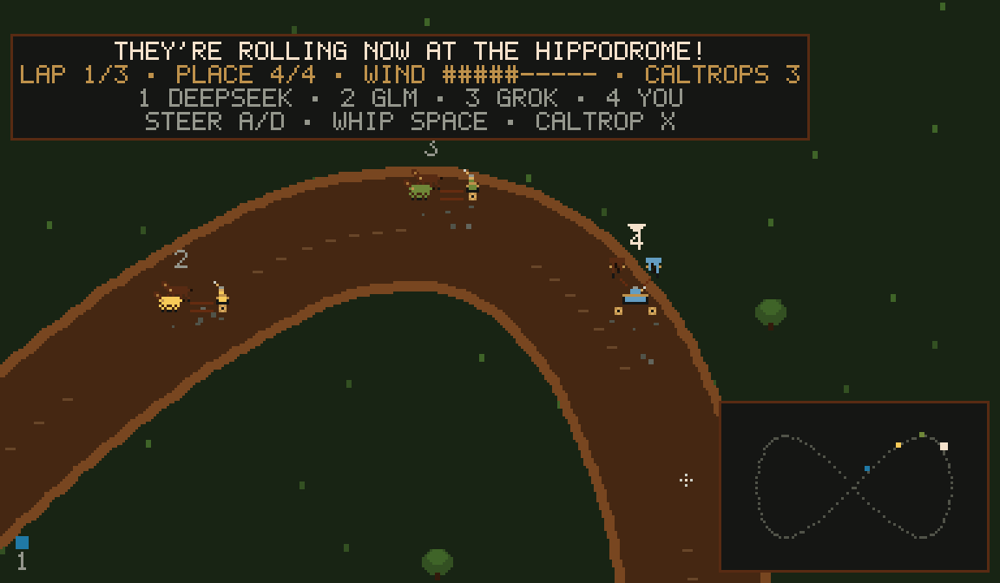
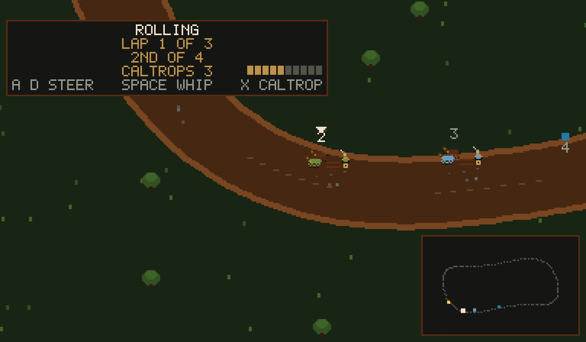

# Chariot racing at the Hippodrome

The realm's Rock n' Roll Racing, with horses. Four chariots, three laps
of the Hippodrome oval, and no clean racing.

## Racing

Hold **E** at the coach plate in the Hippodrome to board. Your chariot
brings your selected grown herd horse (or the best grown horse); with no
eligible horse a keep nag runs for practice, unrecorded. The coach takes the field out to a
course — the Rusty Oval, the Serpent, the Millrace Eight, the
Three-Leaf Clover, or the Hairpin, a different country of twists each
outing, far bigger than the Hippodrome room. The view rides your
chariot round it: arrows at the screen's edge point to whoever you
have left behind (or who has left you), and the minimap in the corner
dots the whole field on the course's outline.

- **A/D** — change lanes; the inside of a corner runs short and hot.
- **Space (whip)** — speed now, paid in wind. A blown team fades until the
  straights give its wind back, at its stamina's pace.
- **X (bomb)** — drop a caltrop for whoever rides your tail (three a race).
  Mind the iron already on the track: rivals carry caltrops too, and
  every spike shows where it fell.
- **Corners** — wherever the course bends hard (and the twisting ones
  bend often), pace is capped by cornering blood, lane, and the bend's
  own tightness; alongside a rival there, nerve decides who gives the
  rail, and the loser may lose his wheels.

Rivals whip with the same lash you do — hard while their teams have wind,
resting it back on the straights — so your edge is judgment: when to
spend the team, which lane to defend, whose tail to iron. A chevron
rides your chariot and every team carries its running place, so the pack
reads at a glance.

**Friends at the reins.** Every other knight standing in the Hippodrome
when you board — a friend in a browser seat counts — takes the reins of a
rival team, one team each, up to three: theirs to steer, whip and iron
with the same keys, under their own name, driving that yard's horse.
While the race runs their keys are the race's alone, as yours are. Each
screen rides its own chariot: the camera, the chevron, the board's lap,
place and wind, and the minimap's bright dot are the viewer's. Your horse
still takes the record and the purse; among the knights, the best placed
wears the crown and the rest a cabbage.

The announcer calls the race off its state ("LET THE CARNAGE BEGIN!").
Places pay 90/45/20 gold, settled with the realm like every mark.

## Horses: lore from usage

A horse is its house and its record (`drive/chivalry.rs`). Each model
house breeds a deterministic bloodline — pace, stamina, corner, nerve —
and service under that house's banner (calls served, tallied in
`Stable::note_service`) seasons the blood and is told back in the horse's
lore: "Its house has answered 1,000 calls under its banner…" A horse's
value is blood + wins + placings + its yard's seasoning.

- **Market** — `/dungeon stable market`: four horses from the market
  houses, blood seasoned by each house's real service. The tally is fed
  live: every finished turn credits its model calls to the serving
  houses' yards (`turn_io::note_horse_service`).
- **Trading** — `/dungeon stable buy <n>` / `sell <n>` at value
  (seven-tenths back), yard of twelve, paid from the realm treasury.
- **Breeding** — `/dungeon stable breed <a> <b>`: the foal carries the
  mean of its parents' blood, one mutation, and both names in its
  pedigree.

`/dungeon stable status` numbers every herd horse and tells its sex, growth,
and lore. `/dungeon stable select <n>` picks a herd horse independently of
Bramble, Cinder and Mist, who remain the jousting mounts.

## Helios and the flower fields

Hold **E** at the ranch's stud book to bring your selected grown herd
mare to Helios, or the first grown mare if the selection is a stallion.
Each attempt costs **400 gold**, with about **one chance in 25** of a foal;
an empty mare yard, full herd, or short purse costs nothing. A successful
covering adds **Phaethon** (colt) or **Aurora** (filly) to that same herd,
with sire **Helios**, the mare's name as dam, and her house. Helios passes
on fixed blood: **pace 9, stamina 9, corner 8, nerve 9**, without mutation.

The foal grows in the flower fields: a yearling after **2 delves won**
since birth, grown and eligible to race or cover after **5**. Its pedigree,
market value and race record use the same horse record as the rest of the
herd. Selling it removes it from the fields; the stud book remembers that
Helios has already given the realm its foal. Ordinary `breed <a> <b>`
between herd horses remains available. Older saves' `ranch.foal` moves
once into the herd, preserving its name, sex and birth win count.

Helios stays the ranch's pride: never owned, sold at market or raceable.
The fast coach's travel gate stands south of the race boarding plate,
so E has one action at either plate. During a race, controls go only to
the chariot; X spends caltrops, and Space spends wind.

## Art floor

Sprites are authored as pixels underneath and rendered by the house
braille surface: `cockpit/assets/dungeon/chariot/` holds two gallop
frames for each heading — side view down the straights (west mirrored),
the team at the viewer down the east end, and rumps-and-cab away up the
west end, so corners never ride sideways. Each yard runs in its own
banner ink (the sheet's house colour, repainted per house), the field
fans out on the gate grid, and race day hangs bunting in the houses'
inks over a crowd on its feet. Regenerate the sheets with
`make_chariot_sprites.py` in the same folder. Mini-game views shrink
their text size so braille renders at movie density — SNES density is
the floor, Atari blocks are not. The gallery shot at the top sits in
`docs/images/realm/` beside the joust's; refresh it from the
`ANGEL_ARENA_SHOTS` renders (one `hippodrome_<course>.ppm` per
course, and `hippodrome_coop_friend.ppm` for the friend's seat, scaled
×3).

The festival pastimes chariot (`pastimes/chariot.rs`) remains the comic
foot race; this is the hippodrome sport, where the horses are real.
