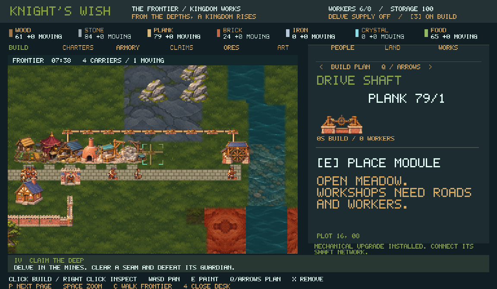

# Kingdom Works: the Frontier

Knights Wish now has a persistent construction and production game. The founding
camp begins with six workers, four road carriers, and limited wood, stone and
food. Workshops produce into local buffers. Carriers take goods along actual
roads to other workshops or the camp. Adventurers secure the rare resource
claims that make metallurgy, enchanted equipment and a castle possible.



## Playing

Open `/world walk`, then press **4** on the surface to open Kingdom Works.

| Key | Build page |
|---|---|
| WASD | Move the plot cursor; scroll the map |
| Q / arrow keys | Cycle plans; road is first, shafts and leylines are later plans |
| E | Pay for construction; hold while moving to paint roads, walls or connectors |
| X | Dismantle a module or road; with a connector selected, remove only that network |
| F | Pause or resume the selected workshop |
| 1 | Cycle that workshop's recipes |
| 2 | Assign a secured, unassigned claim to a mine |
| 3 | Toggle expedition supply |
| P | Cycle Build, Charters, Armory, Claims, Ores, Art, People, Land and Works |
| Space | Toggle close and wide map views |
| C | Bring the company into the constructed frontier |
| 4 | Close the desk |

On Charters and Armory, WASD or Q selects an entry and E funds research or
issues/equips the selected item. On the frontier, WASD walks between the actual
buildings. E at the southern gate returns to the campaign surface. Each player
has their own desk cursor and selection; the kingdom economy is shared.

Build a **forester** near woodland and a **quarry** near rock, beside the founding road. Add a **farmstead** to feed residents, then a sawmill and homes. A clay pit near orange clay feeds a brick kiln; its bricks build cottages, modular walls and passable archways. Wait for carriers to deliver their output. Research the
**Stonecraft charter** to unlock the mason. Housing and storage must also be
connected and completed before they contribute capacity. The objective strip
on the desk explains the next stage.

Rare claims come from delves. The Ore Guide identifies the resource, its routes,
its defenders and their counterplay before you leave. Floor-entry warnings
report the current ore and the actual next floor's resource. Approach a vein
marker to discover it and its two ore sentries. Clear the defenders and the
room, then press E at the seam to challenge its guardian. Win the fight and
press E at the seam again to secure it. Clearing the ordinary room or leaving
and returning does not defeat the guardian. A secured claim persists and may
supply one mine outpost at a time. Claims grant no ore immediately: the mine
must be built, connected, staffed and assigned the claim with **2**.

The Claims ledger has 64 slots. Select a linked claim and press **2** to unlink its outpost; buffered and travelling ore remains. Press **X** twice, with separate key presses, to release an unlinked claim. This frees a slot while preserving earned resource evidence for land charters. Live encounters cannot be retired, and their completed death records remain to prevent duplicate rewards.

| Delve source | Resource | Claim guardian |
|---|---|---|
| Crypt | Coal | Cindermaw |
| Mines, odd depth | Iron ore | Ironroot Colossus |
| Mines, even depth | Moon crystal | Amethyst-crowned Wyrm |
| Dragon Keep | Living ember | Cindermaw |
| Archive, Fungal Deep, Unknown | Crystal | Amethyst-crowned Wyrm |

The sentries are dangerous material-specific enemies with distinct painted
silhouettes and combat behavior:

| Ore enemy | Warning and counterplay |
|---|---|
| Ironplate sentinel | Frontal plate turns shots; flank it or break its guard, then punish the bash recovery |
| Blast crawler | Blinking kegs and marked bomb landings; leave fuse circles and shoot kegs from range |
| Prism stalker | A flash precedes the copied shot; sidestep or raise a barrier after firing |
| Cinderhound | A locked charge lane becomes a burning trail; sidestep and punish its recovery |

Sentries have a finite encounter ledger, so retreat and checkpoint restore do
not create fresh rewards or bypass the guardian requirement. The Ore Guide uses
the same resource mapping and enemy descriptions as the encounters.

The guardians use the game's real boss combat: warning shapes, recovery
windows, damage, phase changes and normal death settlement. Ironroot charges
and slams; Cindermaw leaps and inhales; the Wyrm uses beams and rings. Their
painted rest and wind-up poses appear in combat.

## Building a kingdom

The main chain is **iron claim → outpost → smelter + charcoal → ingots → royal
forge → equipment**. Stone becomes blocks and wood becomes planks. Moon crystal
feeds the mana conduit and enchanter. Food feeds the trail kitchen.

Five charters unlock the next tier: stonecraft, metallurgy, caravans, leycraft,
and sovereignty. Their costs are paid from delivered camp stock. Caravanserais
add four carriers; warehouses add storage. Cottages add beds. Fed residents arrive over time when beds and provisions are available; empty homes do not instantly add workers. A completed castle keep adds sixteen beds and two hundred storage per resource.

The forge initially makes an Iron Oathblade. Press **1** at the forge to choose
other recipes, including generic expedition arms. The enchanter initially
makes a Hearth Wardstone. Finished equipment must be delivered to the camp,
then issued through the Armory. An owned item can be equipped again without
consuming another manufactured copy. Loadouts belong to persistent profiles
and are restored for future expeditions.

| Crafted item | Combat behavior |
|---|---|
| Iron Oathblade | Broad melee sweep |
| Prospectors Pick | Narrow, heavy melee strike |
| Ember Edge | Melee sweep and returning ranged blade |
| Runebound Aegis | Held mana barrier; empowers allied shots |
| Mooncrystal Staff | Three-shard ranged fan |
| Hearth Wardstone | Reusable heal and brief ward, with cooldown |

When supply is enabled, each present knight beginning a new expedition also
consumes available generic arms, rations and ward stock: respectively +2 armour,
1 bomb and ten seconds of arrival protection. Ordinary floor changes do not
issue those supplies again.

## Logistics and simulation

Carriers advance one road tile per simulation second. Workshops advance on
ten-second production shifts. Paused solo play and offline time produce
nothing; work continues while the company is delving. Builders can reach construction over owned dry land, allowing continuous walls and courtyards. Completed productive sites and occupied homes need roads. Roads connect orthogonally to adjacent loading
docks. Removing a road can strand cargo; restoring a route resumes delivery.
Demolishing a destination redirects its cargo to camp. Material stays counted
in camp stock, machine buffers or shipments throughout transit.

Machines consume only their local input buffer when a batch completes.
Carrier dispatch prefers direct producer-to-consumer deliveries. Player priorities order requests; equally prioritized workshops rotate fairly. A caravan carries up to four units. Outputs queue
locally up to 24 units per resource; a full buffer stops production without
consuming its inputs. The selected workshop shows its status, recipe progress,
local inputs and waiting outputs. Construction, disconnection, missing workers,
missing inputs and full output buffers are distinct states.

The Works ledger controls low/normal/high job and delivery priority (**E**), production stock targets (**2**), food reserve (**3**), powered drives (**1**) and pause (**F**). Production targets count camp stock, local buffers and travelling cargo. Pause a workshop to release labour or save its inputs for research. Research and construction spend delivered
camp materials. Changing a recipe discards its unfinished progress and recovers
unused local inputs. Dismantling recovers local materials plus half construction
cost within the current storage limit. Storage is a per-resource capacity.

Residents have persistent names, homes, jobs, hunger, rest and morale. Each eats one harvest every 90 simulation seconds. Newcomers need spare beds and saved food for 120 seconds. The default reserve protects meals and newcomer provisions before the trail kitchen makes rations; setting it to zero explicitly permits the kitchen to take those supplies. Shortages reduce work efficiency and recover when supplied. Residents walk visible paths and prefer roads, but travel time does not yet gate production or construction credit. Relationships and a day/night schedule are not implemented.

The landscape is 72 by 54 plots in nine parcels. A new settlement owns the first 24 by 18 parcel. The Land ledger shows evidence and delivered supplies needed to survey the others; some require a secured ore claim. **2** pins a parcel's resource objective for the next expedition. Shallow fords accept roads; deep water requires paid timber bridges. Old saves retain their original buildable meadow.

There are 26 toolbar plans (24 physical buildings plus two network connectors), the founding camp, 23 resources, 19 recipes and five research charters. Limits are 160 buildings and 64 discovered claims. Claims remain continuous sources. Carriers have limited capacity and physical paths, with no road collision, fluid pipes or conveyor lanes.

## Workshop power

A river waterwheel needs a dry riverbank, a road and one resident. After Stonecraft, lay drive shafts between it and workshops. Shafts may share roads and paid bridges but cannot pass through an unrelated building. In Works, **1** purchases the selected workshop's optional drive; powered operation doubles work rate while preserving recipe costs. A fitted drive can switch back to manual work without paying again.

Mechanical and arcane networks are separate even when they cross on one plot. The waterwheel supplies eight mechanical units. The ley generator supplies ten arcane units and receives bound mana through normal carriers, consuming one local mana per 30 seconds of active charge. Higher-priority consumers receive power first; a machine gets its whole demand or stops. The ledger distinguishes missing roads, labour, fuel, inputs, source connections and insufficient power. Cut a connector and its downstream drive stops without consuming unfinished recipe inputs; repair the network to resume. Dismantling a bridge first requires removing the connectors it carries.

Browser pointer commands select tabs and rows, cycle plans, confirm the main action and place modules directly. Left click places on an empty plot; right click inspects. The camera stays fixed between mouse placements, while WASD resumes cursor panning. Native mouse dispatch is being integrated; keyboard controls work in both clients.

## Modular implementation

`crates/kingdom` is the independent `angel-kingdom` crate. It depends on serde,
with no renderer, host, clock, files, network or randomness. `Catalog::parse`
validates resources, recipes, building plans and acyclic research prerequisites.
`Kingdom::apply` applies atomic commands. `advance_second` runs transport,
construction and production; `work` is a ten-second convenience adapter.

The catalogue is `delve/kingdom/frontier.json`: costs, inputs, outputs, build
time, workers, housing, storage, carriers, landscape siting, power demand/capacity/fuel, connector costs, prerequisites and menu order are data.
Another world can supply another catalogue and encounter/render adapters.
Stable IDs are saved; renaming or removing in-use content needs a save migration.
Incompatible catalogues are not hot-swapped into an existing save.

The Delve adapters live in `rules/industry.rs`, `ore_threats.rs`, `claim_bosses.rs` and
`kingdom_gear.rs`. `Home::industry` and the equipment ledger participate in
revision-based settlement, observation, checkpoint restore and host sync.
An older delayed save cannot replace newer factory work or loadout changes.
Old homes default to an unstarted economy. Resource-qualified deposit IDs keep
Crypt and Mines claims separate, while matching legacy IDs remain readable.
Fresh expeditions retire unsecured sightings and their encounter records;
secured claims and assigned mines persist. Checkpoint restoration and normal
floor transitions retain the active encounter. The finite campaign through
the Unknown currently has ore encounters; infinite Deep floors need their own
adapter and do not spawn them. The host owns the simulation clock;
clients receive state over the existing game wire.

The surface uses the common flat renderer in native and browser clients,
including when the rest of the game is in 3D mode. Collision is regenerated
from the constructed buildings. The campaign's authored castle doors and
interiors remain reachable on the original surface. Browser builders and live
system watchers include the economy crate, catalogue and generated art inputs.

## Art and verification

Painted architecture, terrain, carrier walk poses, monsters and equipment are
retained under `cockpit/assets/kingdom` with prompts and manifests. Build-time
cropping and resizing produce small runtime atlases, combat poses and larger
Armory portraits. Working factories have smoke, furnace sparks and arcane
motion. Three of the six monster concepts are implemented as claim bosses;
Verdigris Mantis, Mossback Briarhorn and Chalkwing Gargoyle remain library
concepts. Copper is an extension resource without a production chain yet.

```sh
CARGO_TARGET_DIR=/tmp/angelx-economy-target cargo test --manifest-path crates/Cargo.toml -p angel-kingdom --offline
# This large engine's test harness builds much smaller without debug symbols.
export CARGO_TARGET_DIR=/tmp/angelx-final-test-target
export CARGO_INCREMENTAL=0 CARGO_PROFILE_TEST_DEBUG=0
cargo test --manifest-path crates/Cargo.toml -p angel-delve --offline --config 'profile.test.package.angel-delve.opt-level=0' --lib industry
cargo test --manifest-path crates/Cargo.toml -p angel-delve --offline --config 'profile.test.package.angel-delve.opt-level=0' --lib ore_threat
cargo test --manifest-path crates/Cargo.toml -p angel-delve --offline --config 'profile.test.package.angel-delve.opt-level=0' --lib claim_boss
cargo test --manifest-path crates/Cargo.toml -p angel-delve --offline --config 'profile.test.package.angel-delve.opt-level=0' --lib kingdom_gear
cargo test --manifest-path crates/Cargo.toml -p angel-delve --offline --config 'profile.test.package.angel-delve.opt-level=0' --lib write_frontier_review -- --ignored --nocapture
cargo test --manifest-path crates/Cargo.toml -p angel-delve --offline --config 'profile.test.package.angel-delve.opt-level=0' --lib write_ore_threat_review -- --ignored --nocapture
```

The economy tests complete a progression session from founding stock through
caravans, research, iron, named equipment, magic and castle construction without
injected intermediate materials. Additional tests cover cargo conservation,
road interruptions, demolition recovery, worker limits, backpressure, catalogue
validation and atomic failures. The ignored visual review writes eight actual
game screens; its two claims are labelled encounter fixtures, while separate
combat tests verify the real guardian gates. Normal-input starter-kit tests
fight the ore sentries and guardians; the Ironroot test then walks to the seam,
secures it, constructs a mine and observes carrier delivery.

A separate real-worker protocol check runs 950 client-input ticks, constructs
a forester, verifies delivered timber, changes desk pages, restores the runtime
checkpoint and compares its economy with the local simulation. Native cockpit
integration and browser WASM checks pass; the full native client and embedded
browser bundle are also built. [Retained screenshots](images/kingdom-works/README.md)
distinguish actual game captures from isolated art fixtures.

## Latest source checkpoint — 2026-11-05

The village and power source passes 67 pure kingdom tests, 56 targeted game/input/encounter checks and the normal-input 519-second village power scenario. Verified screenshots are in [the village capture index](images/kingdom-works/village/README.md). The production native app and installed worker have not yet been rebuilt for this latest source. The preview browser bundle compiled, but the local preview host requires a rebuild with `angel-delve/bend-engine` before it can launch. Native mouse dispatch and frontier hero stride/facing remain pending. See [the paused model-switch handoff](VILLAGE-PRODUCTION.md#model-switch-handoff--2026-11-05-2154-utc) for exact restart commands and remaining work.
