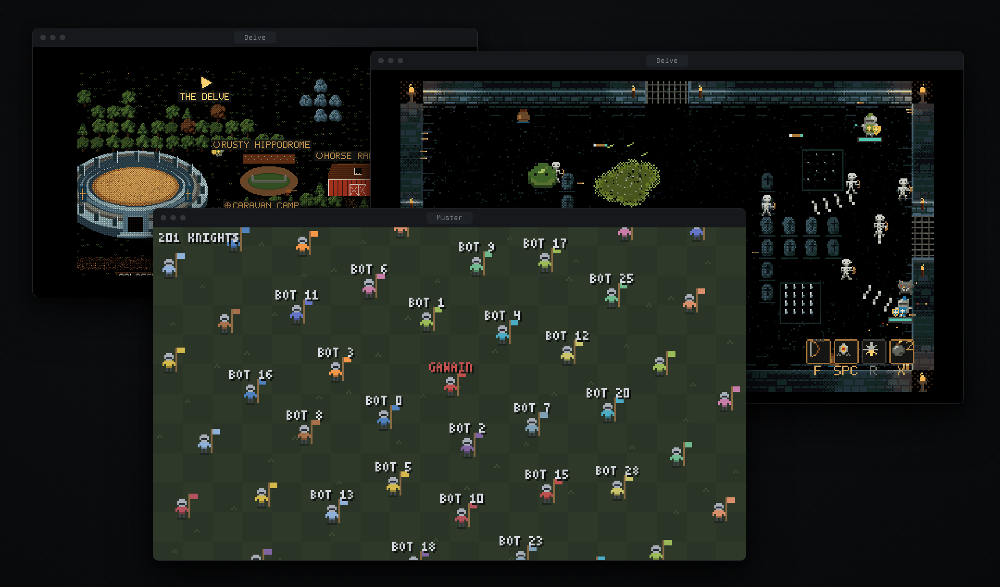

# angelX 0.2.3

The Delve moved onto an engine of its own. One link seats a friend in a
browser or in their own angelX, every player's machine draws its own screen,
and the same engine holds a crowd of two hundred. Above the Delve, the
kingdom became one world to walk, with classes, races, holdings and a great
many small games, and the harness got its benchmark fixes.

## Upgrade

```sh
angelX update
```

Or install fresh with the one line in the [README](../README.md). From a source
checkout, `git pull` and run `./bin/angelX` again; rustup adds the wasm target
the browser client is built with.

## One link, and every seat draws its own screen



The host types `/dungeon_host --3` and gets one link, with its QR code.

- **In a browser,** the link is a playable seat with nothing to install. The
  Delve's own client runs in the page of a desktop browser, with keyboard or
  gamepad.
- **In angelX,** `/dungeon join <link>` plays the same seat from a terminal.
  The host's own screen is a client of the same server.
- **No picture crosses the network.** Each client keeps a copy of the run and
  draws it at its display's rate. Your own knight answers your key on the next
  frame, the host's tick corrects it, and a seat's stream is a few kilobytes
  a second.
- **Seats hold.** A dropped link gets its knight back, a reloaded page takes
  its seat back, and the link survives a host restart.
- **The party is the people playing.** A knight whose player has stepped away
  stands as stone, unseen and unhurt, and wakes the moment they play. Monsters
  are sized for the knights whose players are here. When a run falls or is
  won, Enter takes the party home.
- **Knobs while it runs.** `/dungeon tune` lists and sets the run's numbers
  from the terminal, and `ANGEL_DELVE_DEV=1` gives every page a panel on F2.
- **Two hundred in one session.** The engine is built for a crowd game as well
  as a party. Its test game, the muster, seats 200 knights on one field and
  keeps every client's stream small and steady with all of them in. How it
  is built and measured is in [The engine](ENGINE.md).

## The kingdom, one world to walk

- **The kingdom map.** One world to walk, laid out in regions with a landmark
  for every place. The camera follows each seat, roads are a trot, E enters a
  place, and a gold arrow always shows the way on. A coach round of six posts
  rides between the Keep, the Village, the Horse Ranch, the Colosseum, the
  Labyrinth College and the Delve.
- **Classes.** Five class halls (Archer, Shieldmaiden, Gunner, Swordsman,
  Berserker), the Mage at the Labyrinth College and the Healer at the Chapel.
  Each class has its own figure in every facing, and a Sanctuary's field
  banner changes class below ground.
- **The College of the Labyrinth,** with Bartosz the Wizard, his quests and a
  bestiary lectern.
- **Horses.** The horse ranch and its flower fields, Helios whom nobody rides,
  a horse market at the stables, and chariot racing on five courses. Everyone
  in the Hippodrome races: friends take the rival teams with their own keys
  and see the race from their own chariot.
- **The two-knight joust.** Friends ride each other down the tilt, best of
  three passes, and the gallery wagers real gold.
- **Holdings.** The Court of Deeds sells cleared floors and served castles.
  Stewards, rooms, charters and rents run from it, raiders come for
  low-walled holdings, and angelX's own work keeps them.
- **Errands and small things.** A town crier with errands (a goose heist,
  pigeon post, a crab chase, a forage, the sluice valves), the town's row
  (Haggler's Square, the Royal Soak, Old Dint at the Smithy), Longbow Green,
  the village stocks, a goose that chases whoever honks at it, a chapel bell,
  a wishing well and a cat who purrs for a scratch.

## Below ground

- **New controls.** E interacts, F fires, X throws a bomb, 1 to 4 cast spells
  and Z drinks.
- **A fresh start.** Knights start in their smallclothes and find their gear
  on the first two floors, which teach before they test.
- **Fights that read.** Each floor and foe has its own bullet patterns,
  guardians chain their phases, and two new bosses wait: the Big Ripper and
  Grinwick, the Last Service. More knights bring more pressure.
- **Follies, nooks and races.** The Wax Maze, the Belfry Shoot, the Keg
  Gantry, the Powder Room and Book Hop, where the whole party plays at once.
  A nook hangs off every floor (Grubb's kitchen, the Quiet Room, the Great
  Bellows, the Bone Dominoes, Mother Mort's still, the Bell Loft). From the
  second floor, a race hall holds the Shaft Run, the Griffin Run or the Ore
  Cart, which each knight sees in 3D from behind their own ride.
- **And** the privy in its own window, wishes with looks of their own, a
  painted plate between floors, a playtest ballot on V, clay pots with coins,
  and every room and game left with Esc.

## The harness

- **HTTPS everywhere.** Model calls trust Mozilla's bundled roots together
  with the system's, so a task image without a certificate store still
  reaches its provider.
- **A delivery gate.** A turn with a deadline can name the files and folders
  it must leave and a command that proves the service is up. The harness holds
  the final answer back (twice at most) until they are there.
- **Services that outlive the run.** With `ANGEL_PROC_PERSISTENT_SERVICES=1`,
  `proc_run` takes `persistent=true` and starts a service that keeps running
  after angelX exits, for a checker that looks at it afterwards.
- **A quiet helper.** The local `treebeard` helper model is asked without
  thinking unless an effort is set, so its short calls never come back empty.
- **The city watch.** While a turn runs, two guards of the serving house walk
  between the Keep and its castle.
