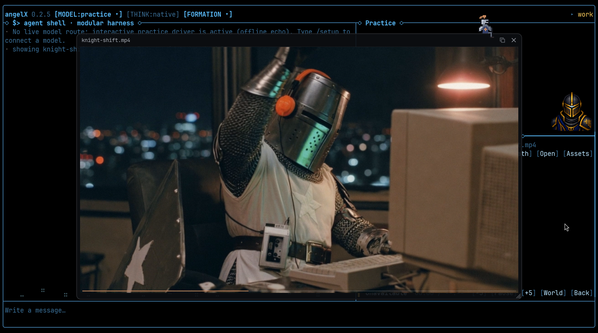
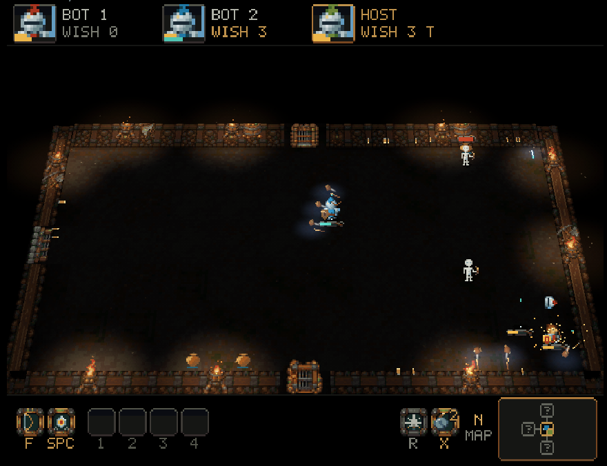

# angelX 0.2.5

angelX opens in its own window. Typed on a desktop, it no longer stays in the
terminal it was typed in: it opens in glass, a GPU window of its own, and
whatever the agent shows (a picture, a video with its sound, a page, a chart,
a 3D model) opens full size in a clear panel above the work, kicked open by a
squire of the serving house or brought in by the wizard. The Delve goes back
to the black dungeon and turns 3D from the fourth floor down, with wishes held
in check, guardians that fight in stages, a map, a party of six, two new
classes, the Swamp of Horrors and five Round Table adventures.

## Upgrade

```sh
angelX update
```

Or install fresh with the one line in the [README](../README.md). From a source
checkout, `git pull` and run `./bin/angelX` again.

## angelX opens in its own window



- **On a desktop, the window.** Started from an app launcher, a keybinding or
  a terminal, angelX opens in glass, drawn with Vulkan on Linux and Metal on
  macOS. Typed in a terminal, the window goes off on its own, so the prompt
  comes back and closing the terminal leaves angelX open. Where no window can
  open (no Vulkan driver, say), angelX runs in the terminal it was typed in
  and says why. Under Hyprland with window swallowing on, the window takes the
  terminal's place and the terminal returns when it closes.
- **The terminal when asked.** `--term` (or `ANGEL_GLASS=0`) keeps the cockpit
  in the terminal, and tmux, SSH, no display and the cockpit's own shell pane
  stay there too. The terminal draws as before.
- **In every package.** The Linux and macOS prebuilts carry the window, and it
  is a default build feature from source. A 0.2.4 package has no window and
  stays in the terminal.
- **Drawn by angelX.** Text comes from angelX's own glyph atlas, with box
  lines, blocks and braille drawn by it. Portraits, realm art, stills, video
  and the Round Table show at full resolution.
- **Its own settings.** `~/.angelX/glass.conf` (one `key value` a line) is
  written on first launch. `ANGEL_GLASS_FONT`, `ANGEL_GLASS_FONT_SIZE`,
  `ANGEL_GLASS_OPACITY`, `ANGEL_GLASS_PADDING`, `ANGEL_GLASS_WALLPAPER`,
  `ANGEL_GLASS_TEXT_GAMMA` and `ANGEL_GLASS_SIZE` override it.
- **Keys.** Ctrl+Shift+V and Shift+Insert paste, and Ctrl+Shift+= / - / 0 zoom
  (Cmd+V and Cmd+= / - / 0 on macOS). They follow the character a key types,
  so other layouts and virtual keyboards work. On macOS the window runs on
  Metal and falls back to the system's emoji, CJK and symbol faces.
- **A start-up in stone.** Walls slide in and lock, and tiles drop in rippling
  from the centre and land with dust. Any key skips it, Ctrl+Shift+T replays
  it, and `ANGEL_GLASS_TRANSITION=0` turns it off.
- **Floating controls.** The mini-viz's actions float up out of the pane on
  the expand arrow, and a gold coin is tossed for every million input tokens.
  Links in the transcript open on click-release, never on a drag.
- **/setup as a scroll.** In the window `/setup` unrolls over the workspace on
  a paper scroll and rolls up on close.

## The showcase


- **Full size, above the work.** What the agent presents with its `present`
  tool, `/show <path>`, Scryglass's Open (`o`) and a finished `graph` chart
  open in a floating panel over the cockpit. `/hide` closes it. In a plain
  terminal nothing changes.
- **Pictures** zoom with the wheel toward the pointer, pan by drag and show
  whole on a double-click. **Video** (with ffmpeg installed, and ffplay for
  its sound) plays with its sound; a click pauses and the line along the
  bottom seeks. **Pages** (Markdown, source, text) scroll in
  the window's font. **Data** (CSV, TSV, JSON of numbers) becomes a chart:
  bars for labels against values, lines for numbers against numbers, up to
  four series. **Models** stand on a lit turntable, a `.glb` with its embedded
  textures and an `.obj` in its vertex colours and materials; a drag turns
  them and leaves them where they are put.
- **The squire.** A pixel knight of the serving house walks out, kicks the
  folded panel open and sits on its roof by the close button, legs over the
  edge, riding along when it is dragged. He wears his house's colours and,
  under the pointer, names himself: his house's first knight, castle and
  epithet. With a formation seated, up to three squires of its other houses
  follow him in. On close they walk the panel off.
- **The wizard.** Charts are brought by the wizard: he raises his staff, a
  spark crosses, the panel unfolds from its middle and the chart is swept in
  under a drift of motes. Over a bar or point he points his staff at it and
  the tip shows its value.
- **Clear glass.** A hairline frame with rounded corners over a faint dim, no
  shadow, the terminal showing through. Drag the title bar to move it,
  double-click to fill the window, and size it from the corner grip.
- **Controls.** Arrows step back and forth through the last 32 showings, the
  copy button copies what is showing (a picture as an image, or as its path
  where the system has no image clipboard; a page or data file as its text; a
  `graph` chart as CSV; a video or model as its path), and the close button
  or Escape with the pointer over the panel closes it.
- **Quick.** Measured in the release build: a picture is ready in about 3 ms, a
  chart or a page in about 14 ms, a video's first frame in about 220 ms and a
  50,000-triangle model in about 290 ms, and a frame of the panel draws in
  about 1 ms. Only the newest showing reaches the panel, so a slow one asked
  for before a quick one gives way to it.

See [SHOWCASE.md](SHOWCASE.md).

## The black dungeon



- **Dark floors.** The floor shows only where a fire, an open door or a hazard
  lights it, walls and props stand in shadow, and each floor takes its light
  from its own doors and braziers. Loot lies as dark cards turning over a pool
  of light.
- **Deeper is 3D.** From the fourth floor down the dungeon stands up as lit 3D
  in the window and on a WebGPU page, and the dragon floor's guardian halls do
  too. `ANGEL_WORLD3D=0` keeps every floor flat.
- **In the window.** The floor tips away from the camera while knights,
  monsters and shots stand upright on it. Fires, shots and motes bloom in
  their own light and the corners fall toward black; `ANGEL_GLASS_POST=0`
  turns that pass off. The browser page draws with WebGPU where it can and
  WebGL2 otherwise, the same way.
- **The party band.** The top of the screen carries a card for each knight
  (face, name, health, mana, FALLEN or AWAY), and the foot carries the skills
  bar: weapon, guard, spells 1-4, ultimate, bombs and hand.
- **A map.** A minimap sits at the right end of the skills bar (top right in
  a terminal), and holding **N** (LT + Back on a pad) shows the whole floor as the party knows it, with doors chained where the
  Boss Key's is shut and a dot for every knight.
- **Floor results.** Between floors each knight's plate counts kills, damage,
  blows taken, aim and gold, stamps honours and names the MVP.
- **A party of six.** Up to six knights play together, the guardian's company
  scales to the table, and fight rooms grow with the party. A knight stands as
  stone until it first moves, so no one is hit while joining.
- **Getting a friend up.** A friend can carry a fallen knight's skull and
  raise the knight in a weakened monster's body until the next Sanctuary, and
  the stairs down bring every fallen knight back at a quarter of their health.
  One knight's fall never ends a run while a friend stands.
- **Music.** The whole Quiet Roads score: village tunes in the realm, a
  fireside one in a Sanctuary, and a playlist for each place and floor.

## Wishes and guardians

- **Three wishes.** Each knight starts a delve with three wishes, gets two more
  on every floor below, and a super wish (two steps of the ladder) when the
  floor's boss falls.
- **Held in check.** Words count strongest first, then half, then a quarter;
  each word has a cap and each floor a budget. Super effects (homing, chain,
  burst, pierce, fork, bounce, volley, orbit) need a pair of families held.
- **Grades.** A learned wish is graded Crude, Fine, Masterwork or Legendary on
  its pictures, and the grade scales its numbers. The scroll takes words
  literally: bigger is size, fire is burn, frost is chill, venom is poison.
- **The cauldron.** When a floor's guardian falls a cauldron rises by the
  stairs. Throw in two spells (E, then 1-4, then E) and one new spell rises,
  themed by what went in. About one brew in eight misfires.
- **Guardians in stages.** An opening, a middle and a rage, each with a cap on
  shots, and charge-ups (charge, slam, beam, leap, inhale) with a closing ring
  and a cry before they strike. A charge-up strikes each knight once and takes
  at most 30 percent of their full health.
- **One boss a floor.** Floors ramp from a few plain monsters to more kinds each
  room deeper, with a chief's camp mid-floor whose elite carries the Boss Key,
  and the guardian at the stairs. Heavy blows hold the room still for a few
  ticks.
- **Gauntlets.** The axe bridge, the hammer row, the boulder run and the saw
  rail warn before they strike, and hurt monsters as readily as knights.
- **Painted bosses.** Guardians and chiefs have painted bodies and their own
  attacks, and every delve pack has hand-drawn small and great rooms.

## New to play

- **Two classes.** The Peasant throws stones and has the ultimate Desertion. The
  Bard fires a stream of notes and sings Lullaby, which puts foes to sleep.
- **The school of the seven banners.** Each class's master stands at a banner
  stone with three missions. Finishing them raises a knight from Squire to
  Adept to Master and hands over gear that never drops.
- **The Swamp of Horrors.** Three floors behind a plate in Sir Damp's Marsh:
  bog that slows, patches of fog, and horrors that show a tell before they
  strike. Free the white horse from the Mire King's pen and Blanchefleur joins
  the stable.
- **Five Round Table adventures**, each with a door on the kingdom map, for up
  to six knights at once:
  - **Lanternward**: a sword, shield and lantern dungeon of five rooms and the
    Warden.
  - **Moonfall**: three days in a town on schedules, five favours, and a bell
    that rewinds it.
  - **Bannerpeak**: a side-view climb of mountain stages and eight banners, to
    King Cinder.
  - **Griffinwing**: a flight over Moonfall Pass; hold F to lock targets and
    roll to turn bolts back.
  - **Lightgallop**: a momentum ride down the Moonwell Road, chased by the
    Dimming.
- **Hall games.** Cinder Stack, Latch Duel, Mossbell (pinball), Brasswake,
  Rafterwake and Pennon Rush; Powder Keg and Gander Joust behind the
  Colosseum's two gates; a Wax Maze hunted by four wraith kings; Siege Trail's
  trebuchets; and the Torchlight Touge, a drift race on some floors. Hold Esc
  for half a second to leave any of them.
- **The open kingdom.** The map is 240 by 176 tiles in eleven biomes, with
  walled great castles, fingerposts at the crossings and thirty discoverables
  placed from the run's seed. The Forest Road frees Old Oak.
- **Gone.** The audience count, fan boxes and Sponsors' Night are gone, and the
  Ore Cart rests until its rework (`ANGEL_DELVE_ORE_CART=1`).

## Cartridges and commands

- **`/dig`.** On Linux x86_64,
  [`examples/cartridges/dig`](examples/cartridges/dig/) plugs in
  [DigUp](https://github.com/ARahim3/DigUp) (MIT), which finds files by what
  they show or say (pictures, PDFs, documents, recordings, video and code) on
  this machine, and names the page, the second or the line of a hit. Its
  `dig_search` tool, which the agent loads only when it needs it, finds code
  by what it does. See [Cartridges](CARTRIDGES.md).
- **`/show` and `/hide`** open and close the showcase.
- **`/table`.** A Round Table work board: host, join by link, post, comment,
  vote, claim, work and submit, with the arbiter accepting and merging.

## The harness

- **Loops stop when asked.** With no acceptance check bound, a `LOOP_DONE`
  claim ends a loop only when an operator note asks the run to wrap up or
  stop; any other note no longer does.
- **A smaller book.** The page telling a seat to run one verifier and finish
  after an edit is gone; loop models read it as a stop.
- **Reader and ledger.** A seat whose reader is taken away is told so, and a
  seat that misses the ledger twice is asked to answer from what it has.
- **Chance code re-run.** A green on code that draws on chance is re-run for
  every source file Git sees changed, however it was written.

## Fixes

- **Delve freezes.** The host mends a run the pages cannot draw before
  publishing it; one had frozen every seat at once, through reloads.
- **The window's memory** stays bounded over a long session, and a corrupt
  font, a lying picture, a giant config or a stuck clipboard can no longer hang
  it. Closing it on NVIDIA exits cleanly.
- **Shots** leave from where the knight is drawn, and other knights are drawn
  nearer to now.
- **Mini-viz clicks.** Only the dungeon sprite opens the Delve, and visible
  controls take their clicks first.

## Security

- rustls 0.23.46 (RUSTSEC-2026-0346 to 0349) and brace-expansion 5.0.12.
- The GLB reader's sizes and offsets are checked arithmetic, and the graphics
  and stage-wire parsers refuse lying headers.
- Release binaries and the source package carry no build paths or user names.
