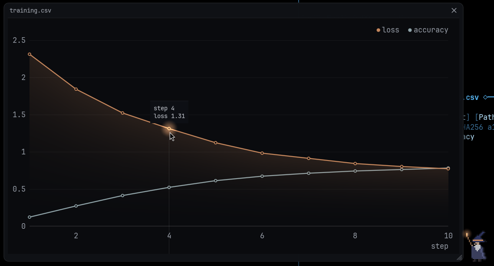
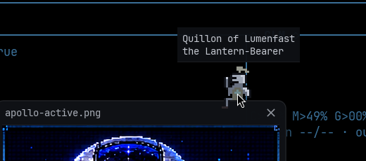
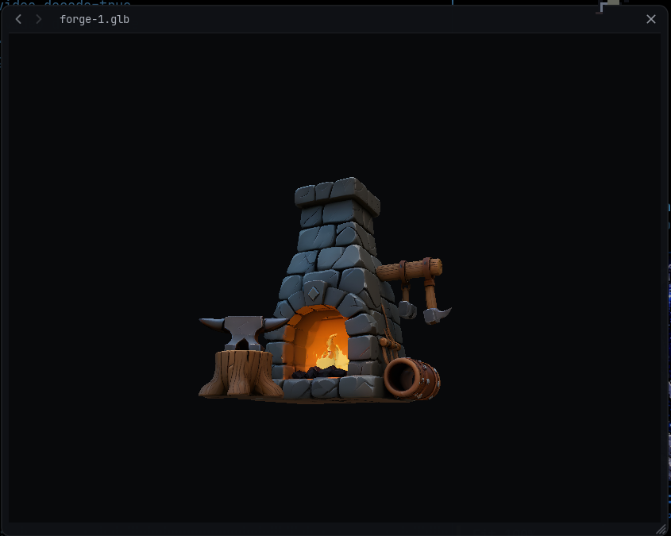

# The showcase

angelX opens in its own window on a desktop (`--term` keeps it in the
terminal). There, whatever the agent presents opens full size in a floating
panel above the terminal. The mini-viz keeps its preview as before; the
showcase is the same media let out of the pane. In a plain terminal nothing
changes.

## What opens it

- The agent's `present` tool (images, video, reports, data).
- `/show <path>`, and Scryglass's **Open** (`o`) on the selected media.
- A chart the `graph` tool finishes.
- `/hide` closes it.

| What | How it shows |
|---|---|
| Picture | decoded at up to twice the window's size; the wheel zooms toward the pointer, a drag pans, a double-click shows it whole |
| Video | decoded by ffmpeg at the window's size (ffmpeg and ffprobe on the PATH; ffplay plays its sound); a click pauses, a progress line along the bottom seeks |
| Page (Markdown, source, text) | laid out in the window's font; the wheel scrolls |
| Data (CSV, TSV, JSON of numbers) | charted instead: labels against values are bars, numbers against numbers are lines (up to four series) |
| `graph` chart | drawn from its planted points |
| Model (`.obj`, `.glb`) | on a turntable, lit: a GLB with its embedded textures, an OBJ in its vertex colours and materials; a drag turns it and it stays where it is left |

## Who brings it in

A **squire** of the serving house kicks the folded panel open, then sits on
its roof by the close button, legs over the edge, and rides along when it is
dragged. He wears his house's colours (the field on plume and tabard, the
charge on his emblem); with no house serving he is the Keep's own. While a
formation is seated, up to three squires of its other houses follow him in
and take seats beside him. Under the pointer a squire raises a hand and names himself:
his house's first knight, his castle and his epithet. Seated, they face the
pointer, stand when it goes to the close button, wave when new media arrives
and swing their legs now and then. On close they walk the panel off.

Charts are brought by the **wizard**, the pixel cousin of the intro's dotted
wizard: he raises his staff, a spark crosses to the panel, it unfolds from its
middle and the chart is swept in under a drift of motes. Over a bar or point
he points his staff at it and its tip shows the value. Idle, he lifts his
staff now and then; on close the panel folds into a flash.

## The panel

It is glass: a hairline frame with rounded corners over a faint dim, the
terminal just showing through, and no shadow. Charts, models and pages carry
no backing of their own; they stand on the glass.

- Drag the title bar to move it; a double-click fills the window.
- The corner grip sizes it.
- The arrows at the left of the bar step back and forth through the last
  thirty-two showings.
- The copy button copies what is showing: a picture as an image (as its path
  where the system has no image clipboard), a page or data file as its text, a
  `graph` chart as its data (CSV), a video or model as its path.
- The close button, or Escape while the pointer is over the panel. Anywhere
  else Escape stays the cockpit's (it interrupts a running turn).

Only the newest showing reaches the panel: a slow one (a big model) asked for
before a quick one gives way to it.

## Code

- `crates/glass/src/showcase.rs`: the panel. The window owns it: its frame,
  controls and pointer handling, in window pixels on the window's thread.
- `crates/glass/src/squire.rs`, `crates/glass/src/wizard.rs`: the heralds,
  drawn as text and timed as functions of time since open or close.
- `cockpit/src/ui/showcase.rs`: what is shown, made off the draw thread
  (pictures, video, pages, models), its history, the houses' colours and
  names.
- `cockpit/src/ui/showcase_chart.rs`, `cockpit/src/ui/showcase_model.rs`:
  charts and smart graphs; OBJ and GLB.
- Tests sit beside each in their own modules.
