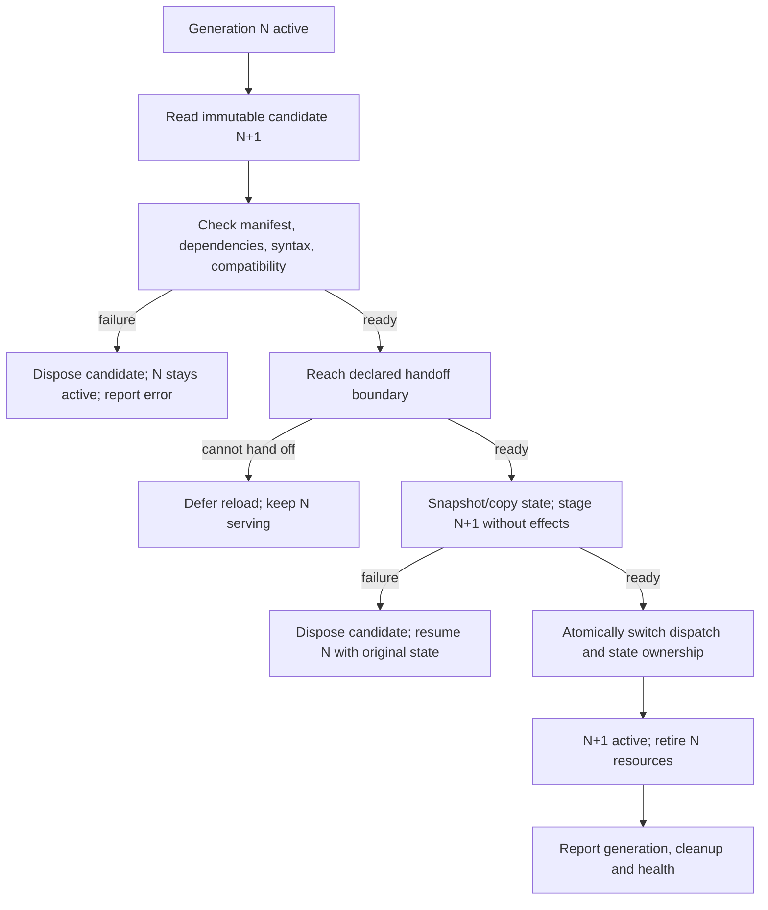

# Lean host and hotloading

[Architecture index](README.md) · [Current operations](operations.md)

**Status: executable-system supervision and the full Delve rules implementation
are implemented.** The host owns authoritative state and external resources;
replaceable workers compute on a complete checkpoint. The shared
runtime-independent kernel now registers stateful JS commands, services, cached
surfaces and prepared resources. API 1 projections still handle cached UI
composition and agent selection policy.

## Executable system boundary

[`angel-live::system`](../../crates/live/src/system.rs) captures an immutable
executable generation and prepares it on a background thread. RPC uses bounded,
length-prefixed JSON frames with API, source generation and request identities.
The exclusive request boundary serializes admission: a candidate restores and
validates copied state, activates, then takes dispatch from the prior process.
Old workers, failed candidates, blocked pipe operations and process groups have
an explicit cleanup owner. Rapid builds coalesce to the newest prepared image.

[`angel-delve-system`](../../crates/delve-system) contains the complete
`Run::step` implementation, built with `angel-delve`'s renderer disabled. Shared
palette/noise primitives are available without importing the rendering engine.
The [development watcher](../../scripts/dev/systems.mjs) builds this target and
atomically publishes its executable while the cockpit remains running.

[`together_sim`](../../crates/realm-host/src/together_sim.rs) retains the actual
multiplayer server, seats, connections, host mutations, committed Run and effect
dispatch. Each rule request receives a copied live checkpoint plus the host's
phrasebook/settings. Only a typed, drawable response replaces the committed Run.
The next native reader and every existing seat then observe that new state.
A failed request pauses rules and retains the last committed state; it is never
blindly replayed. Paused games can accept code replacement without advancing.

The [live-state codec](../../crates/delve/src/rules/runtime_state.rs) is distinct
from durable saves. Its thread-local scope includes the transient fields regular
saves omit, including pending host actions, nested minigame histories and input
latches. Restore checks the version and complete field structure; an incomplete
save cannot silently become a live checkpoint. Static engine IDs use a bounded
process-lifetime symbol table (2,048 IDs, at most 256 bytes each). Normal saves
and public wire serialization retain their prior behavior.

The bridge moves already-built JSON trees into RPC envelopes instead of
serializing/cloning them again. Borrowed checkpoint decoding keeps the complete
schema/shape checks, and the host reuses the resulting validated Run rather than
deserializing the same reply a second time. The local four-player/eight-frame
fixture transfers 72,724 rules bytes instead of 706,172 full-state bytes and
reports 9.6 ms median / 13.1 ms p95 in this local run. This is a fixture result,
not a general frame-time guarantee or completion of module-owned view deltas.

The [lifecycle suite](../../crates/live/tests/systems.rs) covers real process
replacement, schema conversion, rejected preparation/migration/activation,
request-bound handoff, crash/timeout recovery without replay and repeated cleanup.
The [native swap suite](../../crates/delve-system/tests/swap.rs) replaces one
compiled full-rules executable with another, checks changed behavior on the same
run against an uninterrupted reference, and measures complete request cost.
The terminal suite additionally exercises this boundary through the cockpit.

This extraction covers game rules. Native rendering and provider/tool execution
still have their existing owners; their extraction requires an explicit state
and resource contract of its own. The reusable worker protocol provides that
mechanism, while the narrower JS policies below remain independently useful.

## Implemented live boundary

[`cockpit/live/`](../../cockpit/live/) contains cockpit composition, authoritative
Delve tuning, the tool-bubble ranking algorithm, peer reports, world-help
presentation, guardian appearance/labels and optional next-turn guidance.
The [module contract](../../cockpit/README.md#live-application-modules) documents
the JSON manifest, local CommonJS dependencies, reload commands and native schemas.
Adding a text module makes it callable through `/live` without another Rust
command. Editing a dependency changes the content identity of its whole module.

The UI and tuning adapters consume cached native policy. Game candidates are checked against the engine's actual
knobs before publication and atomically overlay normal tuning between ticks.
Removing an override restores the current base without resetting the run or
writing the base file. Remote prediction receives the same effective `Run::tune`.

Tool ranking pins an immutable source/dependency generation on the agent worker.
Editing it does not reset an in-flight turn's activations. A changed generation
reseeds the next eligible turn, including prefix-cached routes. Native admission
checks the selected names and falls back on unknown names or failed evaluation.
The shipped JS BM25 policy is compared with the native implementation on fixtures
and exercised against the real registered tool catalogue.

The UI also consumes cached realm settings and guidance. Report calls use a bounded
mailbox. Capture, debounce and candidate probes stay off the UI thread. Syntax,
API, schema, import and timeout failures retain the prior generation. A pure
projection failing on real request data can restore the previous source; no
model call, tool execution or external effect is replayed. Removed source is
diagnosed while its last working generation remains active.

API 1 invocations use isolated contexts with no retained module state. The
host keeps sessions, jobs, streams and durable stores; changing the guidance
module affects the next interactive turn, not an existing turn's immutable
history snapshot. API 2 adds persistent kernel-owned actor state, command/service dispatch,
cached text surfaces and prepared resource bindings. It does not yet extract
the provider loop, rich Glass scene widgets or all character systems.

The small [loader suite](../../crates/live/src/tests.rs) covers live edits,
dependency freshness, debounce, malformed source, missing imports, incompatible
exports, timeouts, rollback and worker retirement. The native adapter has an
embedded-V8 smoke test, and the real terminal integration suite verifies an
automatic edit, live composer repaint, game-rule replacement and rejected edits
without replacing the host process. Native integration checks actual movement,
base-tuning restoration and panel/copy geometry after live composition changes.
The executable system above implements the lifecycle contract below for game
rules. Other stateful surfaces must establish their own resource contract.

The watcher polls bounded source/asset metadata every 100 ms and debounces a
changed capture for 120 ms. Unchanged packs reuse immutable captured bundles
without rereading or hashing payload bytes. Changed inputs still require matching
content captures and stable metadata; content hashes remain the identity. On
Unix, file identity and change time also detect same-size replacements preserving
modification time. `/reload` forces a full recapture. Unchanged asset bytes are
shared across source generations rather than retained as duplicate pack copies.
The local 16 MiB pack fixture measures 40 µs median / 50 µs p95 idle polls with
zero payload bytes read, versus 38.6 ms median and 32 MiB read for full recapture.

## Shared module kernel and character appearance

[`angel-live::kernel`](../../crates/live/src/kernel.rs) has no Delve, renderer,
provider or V8 dependency. It validates the future dependency graph and stages
copied state/resources before committing an entire group. State revisions and
registry epochs reject stale preparation. Issued service jobs pin caller and
provider generations, reject forged/duplicate completions and dispatch once.
Resource bindings carry reference-counted native data; source assets are
immutable captured bytes. A rejected group drops its prepared resources.

Resource exports use `module/name` keys, so separate packs may each export
`pack`. A declared module/contract import gives the JS backend
`resource(module, name)`: a bounded metadata/value envelope with the exact
provider identity, generation and resource revision. Captured asset bytes stay
in native leases; authored inline values remain bounded JSON. Native `ResourceBinder` adapters receive the same immutable `Resources`
context as their sixth argument and can use its typed bindings or instantiate
the original executable provider. Resources and instances retain the whole
imported closure, including when a backend does not capture it itself.

Provider source, asset and resource-state changes prepare affected dependents
in topological order and commit the entire closure together. Dependency-only
changes preserve state and recompute views/resources; optional `rebind(state,
context)` can adjust copied state without rerunning `migrate`. Native backends
must explicitly implement rebinding. Failed preparation keeps every old state,
resource and pane; revision fences reject stale preparation even when a provider
command leaves its published resource unchanged. Unchanged resources reuse their
native bindings. Existing instances retain their old provider and assets after
new instances switch. The kernel still defers replacement/rebinding while
affected service jobs are active; long-lived job/stream handoff remains open.

The independent-provider PTY test changes one provider under an open dependent
pane, preserves its selection, and rejects an invalid closure in the same host.
Its latest local edit-to-view time was 411 ms. The shipped character modules now
use this mechanism for the resolved loadouts below.

The JS backend implements initialization, migration, reduction, cached views and
resource publication on the existing loader worker. The native application
routes registered slash commands and opens registered surfaces through its
existing module lifecycle; no per-feature command or draw branch is required.
Commands submitted before initial discovery completes queue behind the loader;
they cannot become model messages because their routes are still preparing.
Even an empty catalogue publishes completion. Selection replies wait until the
UI has reconciled the published resources; a busy snapshot lock retains the
reply in the bounded mailbox without resending the command.
The real PTY test installs a new command/surface after startup, changes its state
schema and reducer while the pane stays open, and rejects a failed migration.

[`characters`](../../cockpit/live/characters) publishes an independent art pack.
The host prepares its pixel/image frames once on the worker, applies selected
appearances to existing players, and Glass picks frames without executing JS.
Compatible swaps preserve normalized animation phase; health, position and
cooldowns remain intact. Image assets are captured/validated with code. Native
prepared bindings retain asset leases across replacement. Rules-only checkpoints
exclude appearance bytes, which stay with the host and are reattached after
validated rule replies. Full checkpoints, durable saves and wire views retain
appearance data. This covers frame animation; rigs, blend/state graphs and
broader character-event hooks remain open.

## Executable character abilities

[`abilities`](../../cockpit/live/abilities) publishes `/ability`, `/character`
and `/loadout`, cached ability/character surfaces and per-player
`character-loadout/1` resources. Players select an authored implementation in
any of four slots, plus independent art, sound and effect options. The resolver
imports `ability-pack/1`, `character-art-pack/1`, `sound-pack/1` and `effect-pack/1`
catalogues; native bindings resolve exact declared provider resources.
[`ability-code/spells.js`](../../cockpit/live/ability-code/spells.js) contains
actual timelines, targeting and behavior, rather than only tuning native spells.
The portable game port accepts bounded projectile, heal, collision-aware move
and area-status commands. New authored combinations require no Rust spell variant or App branch;
adding a new physics primitive still changes the foundational port.

`/ability fairies` selects an authored, stationary Fairy Stun Field. Its executable
instance owns the anchor, room identity, pulse schedule and lifetime. The reusable
`status-area` command applies a bounded stun to living enemies within its radius,
respecting walls by default and the existing boss resistance and anti-chain
rules. It uses existing enemy status state, including across rules-worker
checkpoints. Leaving the room or cancelling retires the field; moving the caster
does not move its anchor.

The independent effect pack imports the ability catalogue and derives its ring
radius and lifetime from the same parameters. Six wing-animated sprites orbit the
anchor. Indexed ASCII rows and RGBA palettes prepare once into the shared sprite
format; native and browser Glass use the existing painter. Source, art and media
edits prepare the dependent closure atomically. Existing fields retain their old
code, parameters and graphs while new casts use the replacement. This example
adds the generic status primitive and indexed-frame format to the native
foundation once; subsequent field behavior, tuning, art and cue edits hotload.
Native-worker and embedded real-terminal tests preserve the first field while
changing its radius from 3.5 to 7, cast the replacement beside it, check one versus
two controlled enemies, and cancel both without replacing the host PID. Local
automatic activation took 409–446 ms.

The Kernel's computational `Instance` stages copied state and adapter output.
It leases the precise code/assets behind its source resource. The native
[`ability adapter`](../../crates/realm-host/src/together_abilities.rs) assigns cast
identities, validates complete command batches, then commits actor state, mana,
cooldowns and game mutations under the same simulation lock. Provider preparation
validates definition catalogues and every advertised art/media option. Resolved
binding probes selected timelines against the actual executable provider and
that same game port before publishing player choices.
Runtime-only failures quarantine the owning generation for explicit
`/ability cancel [player]`; they do not partially apply or replay commands.

Rules admit spell input through the ordinary seat/arms path and return transient
cast requests, including through the native rules worker. Live checkpoint schema
2 requires this queue; genuine schema-1 checkpoints migrate explicitly. Durable
saves omit the transient queue. Pending/running casts retain their generation
across code and loadout changes. New casts use new code; paid cooldowns and mana
survive. Once an emitted projectile is primitive data, its native physics and
origin identity continue independently of the completed script timeline.

Instance ticks currently execute one bounded V8 invocation per active generation
on the simulation thread, batching all its players/casts. Admission is limited
to 16 casts and eight executable generations, with 64 actions per batch and the
existing projectile capacity. Capacity pressure defers uncommitted transitions;
unaffordable starts do not block running casts. Keeping execution off the tick's
critical path remains an efficiency boundary to measure and improve.
Each selected slot retains an executable provider resource and its original
ability ID. Installed input uses a local slot alias and the resolved loadout
generation; execution groups by actual provider generation. Sound, effect or art
changes can therefore replace the resolved closure while the same computational
instance continues. Every cast independently retains its selected root and cue
banks. Two players can select different executable providers through authored
resolver changes without another native branch. Art and slots install together
under the simulation lock, preserving health, mana, position and cooldowns.
Schema-2 resolver/art migration carries prior spell and character selections
into the split catalogues. Broader character-event sound overrides and richer
physics remain open.

Ability sound banks now come from [`ability-sounds`](../../cockpit/live/ability-sounds)
and travel with each resolved cast. The module
registers cue mappings and per-player `crystal`, `warm` and `quiet` choices.
Native preparation validates captured PCM16 WAVs and materializes immutable
private files off the frame/tick path. Missing cues/assets or invalid audio reject
the batch/candidate before game state, costs or audio events commit. Old casts
retain their exact bank even when a player changes choices without a code swap.

Link's bounded live-asset registry serves new content at immutable URLs without
restarting its listener or replacing the browser bundle. Queued events, socket
writers and HTTP readers lease original payloads. A three-second window after
actual socket delivery covers bounded media fetches; expired delivery leases
retire on server ticks. Admission is atomic (256 files, 64 MiB, 4,096 prepared
owners). Independent preparations of identical content retain every owner.

Native live playback holds its prepared file until its child exits or is killed
after its bounded duration. Playback owns its voice/fetch workers and reaps them
at shutdown; a main-scope guard drains off-thread file retirement after app
resources drop. Remote native clients fetch, validate content identity
and prepare audio off the UI thread; abandoned-source completions are fenced and
late fetches are dropped. Link uses four resolver workers and a 16-request queue
so a blocking system name lookup cannot extend the caller's wait indefinitely.
Native prepared caches hold at most 16 sounds;
the browser caches 32 AudioBuffers. Active voices retain buffers independently
of cache eviction and module replacement. The shipped examples are original
procedural tones. Existing built-in game sounds still use their current paths.

Ability VFX now use immutable graphs from `ability-effects/effects.js`, including
`crystal`, `ember` and `quiet` player options. Graphs contain ring, disc, particle
and sprite primitives with position, scale, colour and opacity keyframes.
Character and effect sprites share one captured-frame preparation path. The
shared native/browser painter has a 6,000-pixel-work budget per layer pass,
bounded nodes and no evaluation, IO or decoding during paint.

The adapter stages visual admission before actor state, costs, physics and sound
commit. Sixty-four effect instances, eight source generations and 256 KiB of
unique decoded sprite pixels bound active resources. Invalid graphs/cues reject
the complete candidate/batch; capacity pressure defers the complete transition.
Each effect leases its source resource and prepared graph independently of its
cast, until authored expiry, room/raid replacement, player removal or explicit
cancellation. Existing effects keep their original data while new casts use
replacement code/assets or another player-selected bank.

The effect view separates its graph catalogue from birth-timed instances. Its
revision changes only when that view changes; ordinary ticks reuse the previous
serialized scene. A new instance reuses unchanged graph payloads, and guest
patches add/remove this field without rereading the entire Run. Empty scenes add
no field to the existing wire stream. Full live checkpoints use schema 3, with
explicit genuine schema-1/2 migration and completeness checks. Rules RPC carries
an empty scene, and the host restores its own scene after validating replies;
ordinary saves continue to omit these transient effects. These primitives do not
complete character-event hooks, trails/lighting/shake or rich animation graphs.

The local four-player fixture emits 720 game actions, 720 sound events and 720
one-tick VFX over 180 ticks in one executable batch per tick: adapter time is
2.4 ms median / 5.3 ms p95 in the latest shared-machine run (excluding rules IPC,
physics, rendering and actual audio playback). The separate 64-effect particle paint fixture reports
0.077 ms median / 0.085 ms p95, excluding all other frame work.
The strict real-terminal test replaces source in about
0.45 seconds after the watcher optimization, retains a long-running old cast while a new cast completes, then
explicitly cancels and retires the original generation with the same cockpit
PID. It runs against both embedded and separate native rules implementations.
The additional VFX terminal scenario replaces source and its image in
0.41–0.43 seconds with the same PID, retains effects from two generations after
both casts finish, then explicitly cancels and retires them.

## What exists today

| Mechanism | Actual lifecycle | Evidence |
|---|---|---|
| Live application modules | Same native process replaces immutable pure-JS generations between calls; failed candidates retain working code | [`angel-live`](../../crates/live/src/lib.rs), [`V8 backend`](../../crates/live/src/v8.rs), [`native adapter`](../../cockpit/src/agent/hotload.rs), [`app boundary`](../../cockpit/src/app/hotload.rs) |
| JS tool programs | `code_mode::run` creates an isolate/context for the invocation; host tools are callable from JS | [`agent/code_mode.rs`](../../cockpit/src/agent/code_mode.rs), [`harness/code_mode.rs`](../../cockpit/src/agent/harness/code_mode.rs) |
| Node runtime workers | Entry points execute ticks/CLI work; a new process can read changed code, but this is not live replacement inside an existing worker | [`scripts/runtime/`](../../scripts/runtime/), [worker guide](../WORKERS.md) |
| Surface modules | Native activation, suspension, focus and persisted window state; API 2 can register new cached text surfaces while the host runs | [`platform/runtime/mod.rs`](../../cockpit/src/platform/runtime/mod.rs), [`cockpit/modules/`](../../cockpit/modules/) |
| Delve spells/cards | Data-only content delivery; host spell polling skips invalid/partial cards and retries later; manual reload provides diagnostics | [`together_files.rs`](../../crates/realm-host/src/together_files.rs) (`hot_load_spells`), [`dungeon_reforge.rs`](../../crates/realm-host/src/control/dungeon_reforge.rs) |
| Config-only cartridges | Configuration read at startup without rebuilding | [Cartridges](../CARTRIDGES.md#a-config-only-cartridge) |
| Source cartridges | Rust hooks compiled into the binary; changing source needs a rebuild | [`cartridges/`](../../cockpit/src/agent/harness/cartridges/), [source cartridges](../CARTRIDGES.md#a-source-cartridge) |
| Installed runtime resources | Located through a configured root, source-bound installed bundle, checkout or build-time fallback | [`runtime_paths.rs`](../../cockpit/src/platform/runtime_paths.rs), [`release-evidence.mjs`](../../scripts/release/release-evidence.mjs) |

**Content reload, next-process code refresh, surface activation and live code
replacement are four different operations.** The live module host implements
the fourth for pure transforms. Existing V8 tool execution and Node workers are
different execution environments; Node imports are not available in live modules.

## Proposed ownership boundary

Aim for a stable native mechanism layer and replaceable application behavior.
This is a migration hypothesis, not a rule that every current Rust feature must
remain native or that JS necessarily improves every hot path.

| Responsibility | Suggested owner | Boundary requirement |
|---|---|---|
| Terminal lifecycle, low-level input/output, native rendering primitives | Native host initially | JS receives events and submits structured view/state updates, not ownership of terminal teardown |
| Process/PTY handles, provider streams, shared execution resources | Host service initially | Opaque resource IDs and explicit ownership; no pointer-shaped application API |
| Operator authority, workspace identity, action execution and receipts | One authoritative host boundary | Modules use the configured authority; migration neither bypasses it nor adds a new confinement policy |
| Command routing policy, feature composition, report/status projections | JS extraction candidates | Versioned request/result/event shapes, deterministic fixtures |
| Dossier/Habitsmith transforms and related worker policy | JS already in part | Preserve graph writer leases, repo keys and artifact schemas |
| Goals, orchestration and competition-specific behavior | Later JS candidates | Keep in-flight calls, external side effects and durable checkpoints coherent across replacement |
| World/game rules and content composition | Evaluate feature by feature | Measure simulation/frame costs; preserve multiplayer state and deterministic behavior |
| Durable stores and migrations | Explicit owner per store, language-independent | Never let old and new implementations write the same store concurrently |

A small host is a **small stable contract**, not merely a small Rust line count.
Do not move a provider loop first just because it is a large file. Prefer an
already isolated, deterministic transform or status projection whose behavior
can be compared without a network or active model session.

### Contract to settle with the active implementation

For each feature, write down:

- Stable module ID, implementation/content digest and host-contract version.
- Declared dependencies and the immutable dependency generation being loaded.
- Event/request names, payload schemas, result/error shapes and cancellation.
- State owner, state-schema version, empty-state representation and migration.
- Reload boundary: idle only, between requests, or explicitly migratable work.
- Resource ownership: timers, subscriptions, processes, files and writer leases.
- Diagnostic identity: module generation, workspace/run/request IDs and source.

For requests and completions, carry a correlation ID and generation where
applicable. A late event from an old generation must be handled by its owning
request or rejected explicitly, never attached to an unrelated new turn.

Executable systems use worker processes with explicit transport, deadlines and
process-group retirement. JS projections use the existing isolate engine. Any
future persistent isolate service must prove generation retirement and resource
ownership before using the same handoff contract.

## System reload protocol

The executable supervisor implements this lifecycle at the request boundary.
The remaining application surfaces must meet the same contract when extracted.



### Invariants and error paths

1. **Preparation is not activation.** Import/validation must not register live
   handlers, schedule jobs, mutate durable stores or issue tool calls. Prepare
   from one immutable dependency set, not a directory changing mid-import.
2. **One reload transaction per module/dependency group.** Coalesce repeated file
   events by content identity. Never publish half of a mutually dependent update.
   An unchanged digest is a no-op; a missing/deleted file is not an implicit
   instruction to unload a working module.
3. **One active dispatch and one state writer.** Stage a candidate without making
   it a second consumer or writer. Switching handlers, generation identity and
   store ownership must have one commit point. Revoke N's dispatch and write
   authority at that point, before admitting work to N+1; asynchronous cleanup
   must not leave N able to mutate the live store. If that cannot be guaranteed,
   defer the handoff rather than allowing overlapping writers.
4. **No replayed work.** By default, a request stays with the generation that
   accepted it; delay replacement until its declared boundary. A long tool call
   or model stream is not canceled merely because a file changed. Migration of
   in-flight work requires an explicit stronger contract, not automatic retry.
5. **Pre-commit failure preserves N.** Syntax/import/version errors, failed state
   conversion and failed staging leave the original state intact. Discard copied
   state and candidate-owned resources; resume admission to N if it was paused.
6. **State conversion is not destructive.** Validate a copied snapshot and stage
   new durable state before committing ownership. Missing state means a defined
   initial state, not a parse error disguised as an empty object. Unsupported
   versions produce a diagnostic, not silent data loss.
7. **Post-commit rollback is not time travel.** Once N+1 has written state or
   caused external effects, pointing back to N may be unsafe. Require a compatible
   schema and reconciled effects, or fail the feature visibly and use its recovery
   path. Never claim to undo an external submission or command by reloading code.
8. **Cleanup has an owner.** Dispose canceled candidates and retired generations:
   subscriptions, timers, temporary snapshots, owned worker processes and leases.
   Cleanup is idempotent; failure is reported, not silently counted as success.
   Long-lived host-owned jobs follow their own lifecycle, not module teardown.
9. **Reload does not erase evidence.** Preserve session/turn IDs, workspace
   identity, verifier receipts and already visible output. Record both old and
   new source identities and the reload outcome without logging credentials.
10. **The host can run without optional modules.** An empty module directory,
    missing optional dependency or disabled feature should have an explicit state.
    A required dependency failure should identify the affected feature, not hang
    startup or pretend that a request completed.

Node's module cache is a particular implementation concern: adding a query
parameter to one `import()` is not proof of transitive dependency refresh or
cleanup. A replacement needs a coherent generation boundary, whether achieved
with disposable workers, isolates or another verified mechanism.

## Acceptance matrix

**Acceptance contract for every extracted system.** Executable lifecycle and
Delve state/behavior coverage are described above; provider streams and tool
effects remain outside that extraction.
Use the active loader's test entry point and extend its existing fixtures when
implementing. The [current test map](operations.md#test-entry-points) identifies
behavior that must survive extraction.

| Scenario | Observable acceptance |
|---|---|
| Valid replacement while idle | New behavior appears without a native rebuild or host restart; generation/source identity changes |
| Syntax error, missing dependency or incompatible host API | Diagnostic identifies candidate; old behavior and state remain usable |
| Partial save, duplicate watch event, rapid consecutive edits | No partial generation; no duplicate activation; latest accepted digest is observable |
| Transitive dependency changes | All code belongs to the intended dependency snapshot; no old/new import mixture |
| Invalid, missing or incompatible persisted state | Defined initialization or explicit refusal; prior state is not overwritten |
| Reload during model/tool request | Owning generation completes or reload defers; request and side effects are not repeated |
| Late event after handoff | Routed to its original owner or explicitly discarded; cannot corrupt new state |
| Candidate init throws or cleanup is called twice | No leaked handlers, timers, subprocesses or writer leases |
| Active worker crashes or fails after committing effects | Failure surfaces; recovery reconciles state/effects rather than blindly replaying |
| Repeated reloads and final shutdown | Measured resource counts settle; terminal/session shutdown remains owned and complete |
| Empty directory, module removal or disabled module | Explicit state; no accidental unload from a transient filesystem observation |
| Installed bundle without the producing checkout | Feature and dependencies resolve from shipped resources; identity and compatibility remain inspectable |

Measure **edit-to-activation latency**, native rebuilds avoided, reload failures,
resource growth and behavior parity. Keep baseline/candidate settings explicit.
Do not use a faster fresh startup as evidence of successful live replacement.

## First extraction: dossier core

**Implemented organization change, not a hotloader:**

```text
native dossier reader (unchanged)
    <- published JSON <- scripts/runtime/repo-dossier.mjs
                             | paths, caps, redaction, filesystem I/O, writer lease
                             v
                       lib/dossier/core.mjs
                             | mining, graph folding, beliefs, projections
                             +-> lib/research/CausalGraph.js
                             +-> lib/research/causal-loop.mjs
                             +-> lib/evidence/authored-write.mjs
```

The [core](../../lib/dossier/core.mjs) imports only reusable libraries, not Node
builtins, workers or store configuration. It mutates only the caller-supplied
graph; callers own persistence and supply `opts.now` when reproducibility matters.
It neither acquires a lease nor schedules work on import. Store-cap enforcement
and redaction remain at the worker's publication boundary.

The old [worker module](../../scripts/runtime/repo-dossier.mjs) re-exports the
same core bindings and retains its CLI/path/publication API. Scoring and evidence
also retain compatibility entry points under `scripts/runtime/`. There is one
implementation per behavior, not parallel worker/library versions.

Existing [dossier tests](../../tests/scripts/repo-dossier.test.mjs) exercise the
core directly and check the compatibility bindings. The bundled-worker smoke
copies the declared runtime resources into a temporary bundle before launching
the CLIs; it checks import closure, publishes a dossier, lists mined workflows,
and writes a habit draft without a producing checkout beside the workers. It
also checks the proposal budget and that drafts are not installed. The release
inventory explicitly includes the new library files. This does not qualify a
native release or prove live replacement.

This is a smaller future reload target than a provider stream, outer loop or live
multiplayer simulation. Graph ownership and the native reader are unchanged.

## Second extraction: habits and probe rules

[`habits/core.mjs`](../../lib/habits/core.mjs) now owns sequence mining, draft
rendering/deduplication, feedback folding and drift projections. It imports the
dossier core and [`dossier/probes.mjs`](../../lib/dossier/probes.mjs), not the
scheduled dossier worker. The probe library turns supplied observations into
verdicts and updates an in-memory graph; it does not execute commands or read
the environment.

```text
scripts/runtime/habitsmith.mjs       CLI and proposal-file publication
scripts/runtime/habitsmith-tick.mjs  scheduling, gates, spool and status persistence
              |
              v
       lib/habits/core.mjs
              +-> lib/dossier/core.mjs
              +-> lib/dossier/probes.mjs <- scripts/runtime/dossier-tick.mjs
                          |
                          v
                lib/research/causal-loop.mjs
```

Worker compatibility exports remain. Empty inputs, proposal-only behavior,
perpetual fact status, repo-scoped feedback, daily budget handling and cleanup
retain their existing implementations. Existing Habitsmith/probe tests import
the libraries directly and check that the old exports refer to the same bindings.
No worker is started simply to reuse its rules.

## Handoff to the active hotloader

Before integrating this core with a live loader, resolve these with its owner:

1. Which branch/worktree and loader are authoritative? Is there already a module
   manifest and lifecycle API to reuse?
2. Which execution environment hosts modules, and how does it retire a dependency
   generation completely?
3. Which component owns dispatch, state persistence and reload commit/recovery?
4. Which resource bundle and compatibility version ship the module?
5. Which existing verifier demonstrates reload and failure recovery?

Keep this workstream on maps, contracts and a small feature extraction; avoid
parallel edits to an unknown loader. Update this proposal to the actual contract
once that implementation is available.
